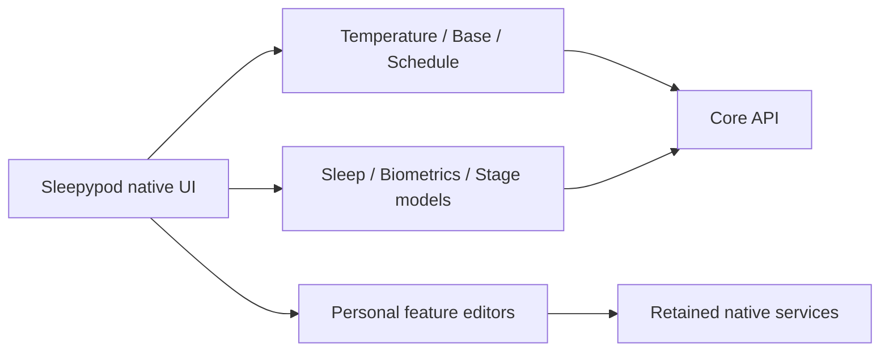

# Title

feat: preserve Sleepypod UI and add native control and sleep parity

# Description

Keep Sleepypod’s Temp, Schedule and Sleep presentation while integrating the retained personal comfort, routines, coaching, Health, Home and Shortcuts services. The retired Free Sleep shell, views and asset catalog are excluded from the build.

Add native Stage and temperature scales, articulated base controls and schedules, alarm and curve editors, Night/Week/Month summaries, source-aware biometrics and Watch references, range exports, and remote stage rules/model workflows. Preserve controller capabilities, conflict checks, explicit hardware actions, provenance and missing-data states.

Validation: 369 local unit tests and the chart interaction flow pass; five live-Pod tests skip without a configured controller. Native presentation/import guards, strict SwiftLint and the contract package build pass. Per-feature iPhone/iPad/accessibility evidence and remaining work are recorded under Integration/parity.

This is a tested integration checkpoint. Full web parity remains in progress, with no new TestFlight upload or release-version change. Build 0.2.0 (7) release evidence is retained separately.
