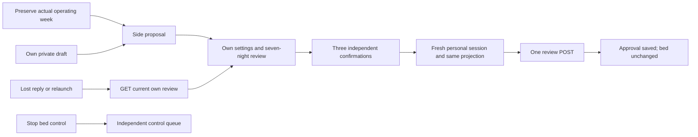

# Shared side review in the native app

Contract: Core PR73, frozen head `9c6e43c0f927cab79ce988ab8101e13517483beb`, `docs/ARRANGEMENT_REVIEW_API_V1.md`. The fixture is copied byte-for-byte to `Integration/Fixtures/arrangement-review-v1.json`; SHA-256 `053b3666e5813cff4ebeffd66c0e200f0762df384373d4c84896b1336c798183`.

## Review only

The optional `arrangementReview` capability must be explicitly true to enter the native preparation screen. Older controllers display an unavailable explanation. Only the owner can propose sides, after confirming that the actual operating week must be preserved. The server snapshots that week; the client never substitutes fresh-account defaults or unpublished drafts. The member sees their own saved private draft, including an intentionally empty week.

Each projection contains only the caller's preferences and full week. The partner projection accepts exactly display name, proposed side and approval status; extra partner-private fields fail decoding. All seven nights are shown, including absent and disabled nights. Expanded details reuse the complete routine renderer for phases, notes, overnight timing, wake temperatures, vibration, wake window, custom snooze duration and taper. The controller timezone and review expiry are explicit.

At accessibility text sizes, the future-side selector uses full-size native choice rows. Side cards stack vertically, and routine details and confirmations wrap within the scrollable form.

Approving requires three independent acknowledgments: own side, own routine, and separate activation. Refreshing, changed facts, expiry, backgrounding, revocation and identity changes disable approval or reset those confirmations. A fresh session and exact displayed projection are checked before each mutation. Either participant can cancel an unconsumed review. Both saved approvals still report that the bed has not switched sides. There is no activation method, endpoint or button.

## Private ephemeral state and recovery

The review body, private settings and request body exist only in memory. They never enter the Keychain ledger, UserDefaults, a replay queue or a disk cache. The personal HTTP client uses fixed routes, a pinned sleeper header and personal device credential, with cookies, caching and redirects disabled. It never uses owner-control fallback.

Each action sends one POST. Any unconfirmed response, including an HTTP error after a committed approval, disables further mutations. Recovery uses GET only: known approval/cancellation reviews are read by their original ID, followed by the current review. A lost proposal or a relaunched app checks the latest review. It never replays the previous request, and no action is possible after relaunch before that read. A missing original review keeps recovery unresolved. The UI reports current server state rather than asserting the outcome of an unverifiable earlier request.

Account switches, session/assignment changes and sign-out invalidate and hide the previous projection. Parent refreshes recreate an invalidated child. Private draft changes discard the displayed review; changing settings on another device is detected during fresh preflight. Review work has its own busy state and no dependency in the temperature/control queue, so a pending review cannot block Stop.

## Verification and release boundary

Contract, transport and workspace tests cover both people, strict projections, bounded request lifetime, all confirmations, preservation-only proposals, deliberately empty weeks, lost replies/relaunch, expiry/clock rollback, stale snapshots, revocation, account changes during awaits, invalidation recovery and no private review persistence. The shared-parent test holds a review GET while successfully issuing a synthetic Stop request. UI scenarios use an in-memory synthetic server and vault and cannot contact a Pod.

This slice does not change the app version, TestFlight distribution, runtime flags, bed assignment, operating schedules, hardware, private history or Apple Health. Version remains 0.4.2 (15). Shared activation and its coordinated rollback remain a separate integration gate. The previously observed intermittent Appearance-menu automation failure also remains a separate release qualification item; this change does not alter Appearance controls.
