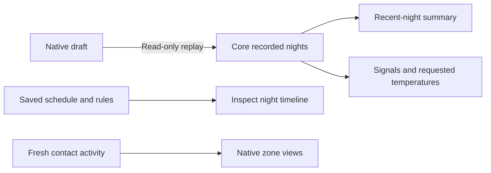

The native app could edit Autopilot rules but lacked the web’s multi-night comparisons and combined night plan. This adds saved-rule summaries, read-only draft replay over 1–14 nights, and a scrubbed timeline of schedules, manual holds, possible rule windows and recorded firings. Time/day windows preserve compound-condition uncertainty and the Pod’s daylight-saving transitions.

Replay charts now compare signals and requested temperatures, show clamp/time-window bands, and separate firing/suppression events. Live contact activity rejects stale readings; recorded pressure playback uses a stable whole-night color scale with play/pause and scrubbing. Activity filters recognize missing signals using Core’s actual reason code.

Validation is recorded in `Integration/parity/AUTOPILOT_PLANNING_VALIDATION.md`, including unit/transport checks and iPhone/iPad/rendered evidence. Fixtures are explicitly synthetic; tests send no commands to a real Pod. This advances the ongoing native parity effort; System/settings work and the final TestFlight release remain open.
