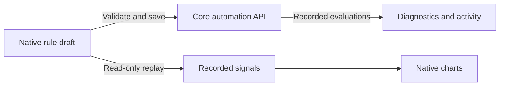

The iOS app could not manage Core's Autopilot rules or inspect its recorded evaluations. This adds native rule editing, atomic Off/Dry run/Active changes, global enable, draft replay, diagnostics, activity history and recorded pressure-zone playback within Sleepypod's existing navigation and grouped cards. Personal comfort remains available.

The editor preserves nested conditions and expressions, explicitly clears nullable side/cooldown fields, and retains drafts when a fresh read detects a conflicting edit. Replay keeps missing readings as gaps and labels dry runs, nominal-baseline estimates and actual sent commands separately. Night boundaries and displayed controller times use the Pod's timezone.

Validation and rendered evidence are recorded in `Integration/parity/AUTOPILOT_VALIDATION.md`. The replay fixture is generated by Core's pure backtest function using synthetic readings; it does not represent personal data or bed commands.

This is a completed implementation slice within the ongoing native parity project. Multi-night summaries, the combined schedule/rule timeline and the remaining configuration audit are tracked separately; this PR does not claim a new TestFlight release or completed full-app parity.
