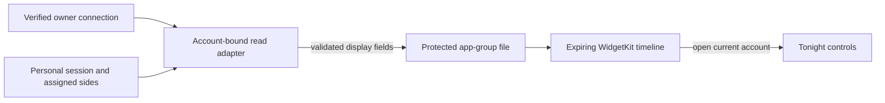

# Bed status widgets

The Lock Screen, Home Screen and StandBy use a real WidgetKit extension. Its single purpose is to show the last checked bed target for the app's selected account and sides, then open those controls. It is a saved status view, not a live temperature controller.

## Data and account boundary

The iPhone uses a separate instance of the existing owner/personal read adapter. Widget refreshes cannot replace the Watch's reviewed command lease. Each foreground read checks the account before and after the request, validates the source observation, and exports only side labels, requested targets, power state, a wake-plan summary and a check time. Personal accounts use the controller's assignment; owner controls name the selected physical sides. Different targets remain separate.

No connection key, endpoint, person identifier, command lease, Health sample or sleep report is shared with the extension. The app-group file is atomically written, excluded from backup and protected until the first device unlock. Displayed content is marked `privacySensitive` for system redaction. Switching account, side, connection or app mode withdraws the saved copy; starting a new app session also clears it before reading. Authentication, transport and malformed-source failures withdraw it.

Temperature values expire after 15 minutes. A separately validated, absolute wake occurrence can remain until its scheduled time or 18 hours after checking, whichever comes first. This lets StandBy show a **Saved wake** overnight without retaining old targets or changing “tomorrow” into the wrong day. Wake labels use the bed's time zone and name the physical side. Future timeline entries perform both transitions without waiting for another fetch. Values are always labeled **Saved**. WidgetKit controls rendering and refresh scheduling; the app cannot promise immediate removal of a previously rendered system snapshot. There is no widget networking or background actuator dispatch. A tap is an exact, parameter-free navigation link. Fresh authentication and the normal app controls remain authoritative.

## Presentation

- Small: large target, physical assignment and saved age. Its removable background supports StandBy and night rendering.
- After the targets expire, an available upcoming wake becomes the main content. This is the last checked plan, not evidence that vibration or warming occurred.
- Medium: the same target plus the last checked wake plan.
- Lock Screen rectangular/inline/circular: compact target, saved-state labeling and a direct link to the app.
- Missing, expired, corrupt or unshared storage: **Open sleepypod** with an explanation, never a fabricated value.
- System fonts, semantic foreground/background, SF Symbols and text labels support light/dark, tinted, vibrant and larger-text appearances. No color alone indicates a state. There is no decorative animation.
- At accessibility text sizes the small and medium widgets simplify to two lines with the saved target or wake time and physical side labels (L/R). VoiceOver retains the check time; text is not allowed to overflow the fixed widget boundary.

Apple references: [WidgetKit extension](https://developer.apple.com/documentation/widgetkit/creating-a-widget-extension), [widget design](https://developer.apple.com/design/human-interface-guidelines/widgets), [keeping widgets current](https://developer.apple.com/documentation/widgetkit/keeping-a-widget-up-to-date).

## Release requirements

Register the `group.com.lucaandrea.freesleep.widgets` App Group and `com.lucaandrea.freesleep.widgets` extension on the existing Luca Andrea Collins team. Enable that group for the app and extension, regenerate the app's existing distribution profile with the group, and create `Free Sleep Widgets App Store 2026`. The export/upload profile maps include the extension. Do not ship an unsigned extension or remove the existing app's Health/Home capabilities to resolve signing.

Simulator compilation and unit tests do not establish provisioning, real Lock Screen privacy, StandBy rendering or refresh behavior. Before distribution verify the signed app and embedded extension share the expected group. Then check an actual installed widget, account/side switching, an app sign-out, a disconnected Pod and expiration on iPhone. Confirm the widget opens the correct tab from both a running and terminated app. No bed setting needs to change for those checks.

This source implementation remains separate from the currently distributed build until those release checks are recorded.

## Local validation — 12 November 2026

The real app and embedded WidgetKit extension compile together for Simulator. The production SwiftUI content passed 10 iPhone and 10 iPad scenarios at conservative system widget dimensions, including different left/right targets, Off, missing/expired data, overnight saved wake and the largest accessibility text size. Screenshots were inspected for fixed-boundary clipping. This is a production-view harness, not a claim that SpringBoard, Lock Screen or StandBy hosting was physically tested.

The complete local unit/transport run passed 1,737 tests, with 9 skipped tests recorded separately in its result bundle. Strict SwiftLint, project whitespace checks, workflow YAML parsing and all 25 existing build-support tests passed. Early runs exposed an inaccessible widget-family override and oversized preview fixtures; these were corrected before the final runs. Repeated binary updates also left the disposable Simulator in an app-update launch state; final UI checks used a fresh simulator with the same compiled bundle. Failed results were retained separately from passing evidence.
