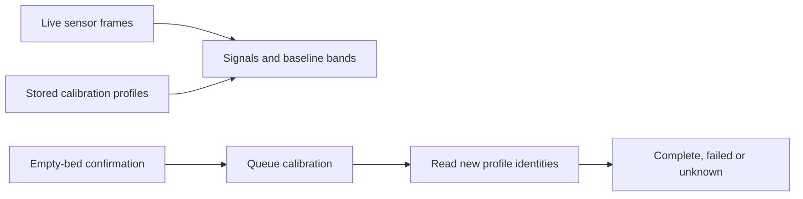

The native calibration sheet could report success from an older completed profile and did not expose the web app's signal-versus-baseline inspection. System → Calibration now shows per-side profiles, recent signal charts, validity, individual/full calibration and explicit queued, failed and unknown outcomes using Sleepypod's existing design components.

New results must have changed profile identities before a requested calibration is considered complete. Sensor decoding also retains valid surface readings when ambient fields are missing and supports legacy Pod temperature/capacitance frames without changing zone positions.

Eleven focused unit tests, the iPhone/iPad/maximum-text interaction flow, strict SwiftLint and the native presentation guard pass. Fifteen screenshots are retained for review.

Validation and physical-device limits are recorded in `Integration/parity/CALIBRATION_VALIDATION.md`. No live Pod calibration or TestFlight release is included.
