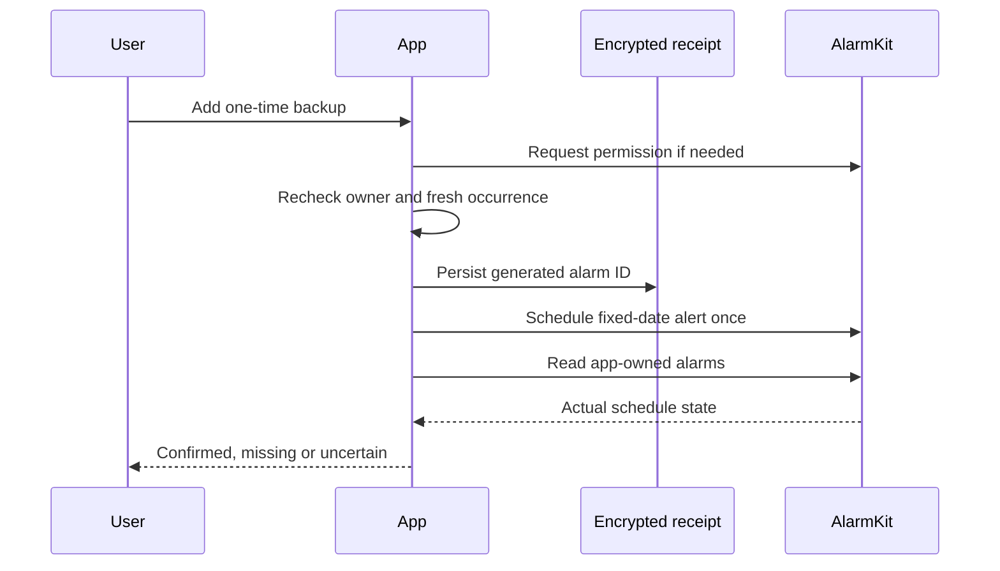

# Clear wake plan and optional system backup

The owner app renders Core's additive, canonical warm-up metadata alongside the
selected occurrence. Old controllers remain readable with an explicit unknown
warming time. Failed or older-than-90-second reads withdraw occurrence controls;
backgrounding or changing the owner invalidates the read. Weekly schedules remain
independent of a one-occurrence override.

The editor leads with time, days/side, wake temperature and vibration duration.
Movement windows, snooze and firmware-dependent style are disclosed separately.
Changing only a basic field preserves the advanced values. Test and Stop stay paired.

## AlarmKit lifecycle

AlarmKit is available on the app's existing iOS/iPadOS 26 target. The permission
purpose string explains the optional app-owned backup and its Silent/Focus behavior.
An explicit Add action requests permission, validates a fresh owner-scoped Pod read,
then stores an encrypted receipt before calling the OS. The absolute date follows
the Pod occurrence, including its DST resolution, rather than the phone's timezone.
The reviewed owner identity is captured with the occurrence and checked before any
permission request. A replacement confirmation pins that same plan and identity;
changing accounts or receiving a different plan requires a new review.

The app tracks one backup. Replacement verifies removal of the prior tracked ID
before creating another, and interruption never triggers an automatic scheduling
retry. A lost acknowledgment preserves the ID for readback/cancellation. Changing
owner during the request attempts cancellation even if the acknowledgment is lost;
a failed cancellation preserves its receipt for later recovery. Foreground identity
checks reconcile previous-owner receipts. Ordinary Demo neither reads saved private
backup details nor schedules/cancels an actual alert.

This is a fixed-date system alert with Stop, not a countdown or snooze experience;
no countdown Live Activity is advertised. Other Clock alarms are not accessed.
Changing a Pod occurrence does not silently change an existing backup: the screen
shows a mismatch and requires explicit replacement. Home lights, shades and audio
remain separately qualified; this screen does not fabricate their delivery.

Apple references: [AlarmKit session](https://developer.apple.com/videos/play/wwdc2025/230/)
and [scheduling documentation](https://developer.apple.com/documentation/AlarmKit/scheduling-an-alarm-with-alarmkit).

## Validation and limits

Local policy tests cover denied permission, stale/future receipts, unavailable Pod
plans, duplicate taps, local storage failure, lost acknowledgment, changed identity,
missing/mismatched system state and cancellation failure. UI checks cover the simple
and expanded editor, retained advanced settings, one-occurrence editing, readback,
and practice-mode isolation on iPhone/iPad. Exact result bundles are recorded before
release. The earlier UI run revealed an accessibility identifier placed on a whole
disclosure group; the fix places it on the label so child controls retain their IDs.

Verified locally on 10 November 2026:

- `/tmp/sleepypod-wake-ipad-final.xcresult`: 23 policy and nine UI tests passed,
  including the largest accessibility text size in landscape.
- `/tmp/sleepypod-wake-phone-identity-final.xcresult`: 23 policy and three focused
  UI tests passed on the final account-identity and contrast changes. The earlier
  full iPhone run `/tmp/sleepypod-wake-phone-v2.xcresult` passed all eight UI tests.
- Strict SwiftLint passed. The Core-generated fixture contains 12 actual store
  projections from source commit `816f1269`; missing metadata on older controllers
  remains readable with warming time explicitly unknown.
- The first landscape screenshots used an application-frame crop with incorrect
  portrait bounds. Capture was changed to the complete simulator display; this is
  a test-evidence correction, not a changed app layout.

No real phone alarm, Pod thermal/vibration action or accessory action was performed.
System scheduling acknowledgment is not physical alarm-delivery qualification.
- `/tmp/sleepypod-wake-ipad-display-capture.xcresult`: the corrected full-display
  capture passed and was visually reviewed at maximum text size in landscape;
  Save/Cancel and expanded controls remain within the sheet and reachable.
