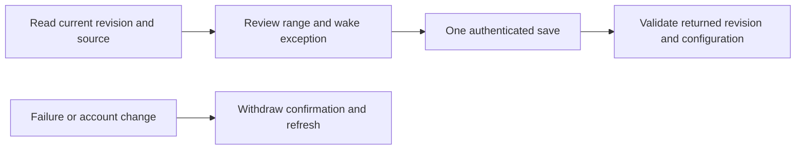

# Automatic comfort range on iPhone and iPad

Approved improvement 04 gives the owner an automatic temperature range, separate
from personal learning mode and wake-alarm temperature. The temperature screen's
side-specific Comfort limit link works in Cards and Stage. The editor shows the
physical zone, its linked schedule source, the saved range and the next wake-warming
start in the Pod's timezone. Defaults are disabled; a displayed draft never implies
activation.

The shared Core controller enforces the range across schedules, general Autopilot
rules, run-once plans, power-on fallbacks and pump recovery. Explicit manual holds
retain their temporary override; only a persisted current wake occurrence gets a
wake exception. This app does not run a competing controller or change learning's
Off/Preview/Active status.

`GET` and `PUT /api/v1/temperature/comfort-limit` use the existing exact-origin owner
transport. A save includes the original source side and revision; conflict or a
lost response requires a fresh read. There is no background mutation queue. Late
responses and account/Pod changes cannot confirm an obsolete configuration. An old
controller without the endpoint gets reconnect/update guidance. Owner controls are
unavailable in a personal-account workspace until its own authorization contract is
implemented.

The Demo editor is explicitly marked practice and uses only an in-memory actor.
It never connects to the Pod, persists an activated setting, or enables learning.
The normal editor supports system text sizing and scrolling, with native steppers
and explicit cancel/refresh controls.

## Validation

Unit cases cover range limits, version/side/wake validation, old status compatibility,
exact REST payloads, revision conflicts, failed saves, account changes and explicit
invalidation. Signed simulator UI cases exercise navigation, the editor, saving and
large text. Simulator results do not establish a live Pod target or physical water
temperature. TestFlight, live controller activation and hardware acceptance remain
separate release steps.

On 10 November 2026, the signed iPhone simulator passed eight unit/transport cases
and two UI walkthroughs (normal dark and accessibility XXXL light). The signed
iPad simulator passed both walkthroughs. Result bundles:
`/tmp/sleepypod-limit-native-4.xcresult` and `/tmp/sleepypod-limit-ipad.xcresult`.
Screenshots exposed a low-contrast primary-button label during development; it
was corrected with the existing theme colors and the final images were reviewed.
Strict SwiftLint and the simulator build passed. Hosted CI is additionally wired
for both device forms by `comfort-limit-ui.yml`.
