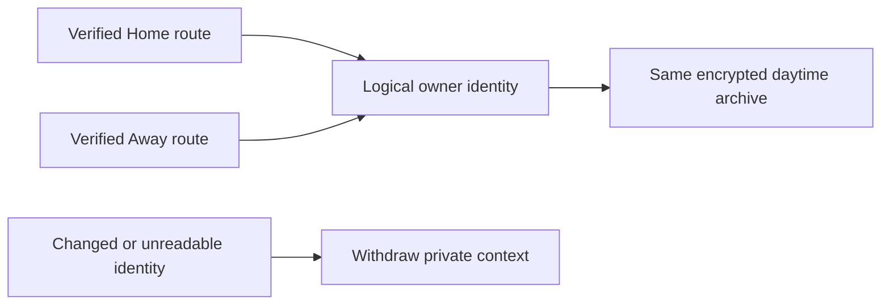

# Verified connections and private context integration

The connection, daytime Health context and detailed journal branches now build
and run together on top of the consolidated everyday-screen release. Existing
connection, recording, care and comfort tests remain enabled.

## Integration behavior

- Home/Away recovery changes transport, not the logical owner. The daytime
  archive uses `OwnerDataIdentity` through the host/framework bridge, preserving
  the exact earlier archive encoding. Unreadable route profiles, changed
  credentials and personal-account boundaries withdraw this owner's context.
- Model fixtures ship in the unit-test bundle and are loaded from that bundle.
  No simulator test depends on access to the Mac checkout.
- Both daytime and journal DEBUG preview entry points remain present alongside
  connection fixtures. Preview data cannot read Health or send bed commands.
- The context UI workflow uses the ARM64 macOS runner, matching the everyday
  workflow; superseded runs cancel. Xcode 26.3, the iOS 26 runtime selection,
  interaction assertions and test time bounds remain unchanged.

## Local validation, 11 November 2026

Source integration commit: `09af4dc` (plus this documentation-only receipt).

- Signed arm64/x86_64 simulator build passed on Xcode 27.2.
- Complete model/application regression: **1,370 passed, nine existing live-service
  skips, zero failures** (`/tmp/SleepypodConnectedContextUnits-v1.xcresult`).
- Combined UI suite: **17 passed on iPhone and 17 on iPad**, zero failures or
  skips. Each covers four route, five connection enrollment, three daytime
  context and five journal scenarios. Receipts:
  `/tmp/SleepypodConnectedContext-iPhone-v1.xcresult` and
  `/tmp/SleepypodConnectedContext-iPad-v1.xcresult`.
- The 114 retained captures were indexed and checked against the prior reviewed
  presentations, including the full phone mismatch message. The earlier scoped
  independent design verdicts remain documented with each feature. This combined
  regression is not a new whole-app design certification.
- Two nonspecific SwiftUI invalid-frame runtime warnings remain in the iPad
  result; the interactions completed and no corresponding visible regression
  was found in the retained captures. They are not erased from the receipt.
- Strict source lint, workflow YAML/shell parsing and `git diff --check` passed.

These are synthetic local checks. Hosted checks, TestFlight, real Health delivery,
gateway provisioning, workplace/cellular access and physical operation are
separate acceptance gates. No phone, Pod, routines or household pairings changed.

## Hosted compiler compatibility follow-up

The first consolidated hosted build at `b0c4450` failed before tests: Swift 6.2.4
in Xcode 26.3 aborted while emitting an actor-isolated conversion thunk for
`MorningJournalContextDraft` in `MorningJournalScreen`. The compiler stack names
`SyncCallEmission::setArgs`; this was not a failed application assertion.
The original log is retained at `/tmp/sleepypod-pr67-everyday-failure.log`.

The context binding now uses an explicit setter closure instead of passing an
isolated method reference. The same `editContext` method still performs the write.
A signed arm64/x86_64 Xcode 27.2 build passes. Focused journal model/persistence
checks passed 23 tests and all five journal interaction scenarios passed on the
iPhone simulator (`/tmp/SleepypodConnectedContext-compiler-fix.xcresult`). Hosted
Xcode 26.3 remains the decisive compatibility check. No runtime behavior or test
requirement was removed.
