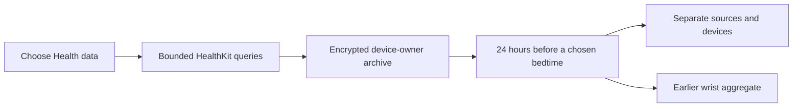

# Optional daytime context

Approved improvement 09 adds an explicit, separate Health opt-in for workouts,
exercise minutes, active energy, steps and sleeping wrist temperature. The entry
is in the existing Health history card. It does not expand sleep-import permission
silently, send context to a provider or the Pod, or modify a temperature target.

## Data semantics

- Each read covers up to 90 elapsed days. Anchored queries page through at most
  40,000 changes per type; reaching the bound withdraws that type rather than
  presenting a truncated total as complete. Deleted identifiers are removed.
- The retrospective window is 24 elapsed hours before the selected bedtime.
  Its time zone is shown. A sample crossing a boundary is excluded rather than
  prorated. This remains deterministic across travel and daylight-saving changes.
- Workout duration, exercise minutes, active energy and steps are separate
  measures. Source and available HealthKit-local device identities stay separate,
  including two devices of the same model. An unidentified device is not joined to
  an identified one; missing identifiers cannot establish which physical device
  contributed a record. Local identifiers are not portable between devices and
  may change after an update. No cross-device identity is inferred.
  Exact repeated UUIDs count once; conflicting UUID records reject the snapshot.
  Every member of an overlapping component is excluded from the total. Adjacent
  samples remain usable. Distinct instantaneous samples at the same instant are
  ambiguous; an ordinary instantaneous quantity sample is valid.
- Sleeping wrist temperature is the absolute Celsius value supplied by HealthKit.
  It is a nightly aggregate, not live body temperature or Health's displayed change
  from a baseline. Only a prior interval ending before the selected bedtime and
  starting within seven days is eligible. Same-night results cannot predict their
  own bedtime. Sources stay separate.
- No returned records, an explicit zero sample, an unavailable query and incomplete
  query coverage have different representations. Health does not disclose denied
  read permission; an empty result is not proof that the person was inactive.

## Privacy and lifecycle

The archive uses the existing authenticated AES-GCM private snapshot store,
device-only Keychain key and complete file protection, excluded from backup.
Its scope includes the installation identity, owner credential revision and
household boundary revision. Changing identity, locking or backgrounding withdraws
in-memory data; late asynchronous results cannot write into a different scope.
Demo and personal-account preparation cannot read the installation owner's Health
context. Personal-account context remains a separate household delivery item.

After explicit opt-in, opening the screen or returning to the app may refresh an
old import under the existing morning/six-hour refresh policy. There is no promise
of unattended background delivery. A successful empty read replaces previous
records; an unsuccessful read retains the dated previous archive and explains the
failure. Corrupt saved data is not silently overwritten.

Turn off and remove requires confirmation, removes this scope's local archive,
invalidates pending reads and disables subsequent automatic reads. It does not
delete Apple Health data, sleep history, saved reports or other account archives.

## Evidence and remaining work

Model and workspace tests cover source separation, duplicate/overlap handling,
window boundaries, prior-wrist semantics, missingness, invalid clocks, encrypted
identity isolation, explicit consent, account changes, device locking, cancellation,
deletion during import and failed-read preservation. Simulator practice states are
explicitly labeled examples and cannot request Health access or delete real data.

This increment is the import and inspection foundation. The separate
[journal context](JOURNAL_CONTEXT.md) implementation adds optional timing,
quantity and descriptive comfort comparisons. Linking Health context to comfort,
held-out predictive evaluation and any reviewed control policy remain separate
improvements; no beneficial bed adjustment is claimed merely because context was
imported. Actual Watch permission, locked-device behavior and delivery require
physical verification. [Combined connection/context validation](CONNECTED_CONTEXT_RELEASE.md)
also records stable archive ownership across verified Home/Away transport changes.

## Local validation receipt — November 10, 2026

- Signed iPhone 18 Pro / iPad Pro simulator builds on Xcode 27.2 succeeded.
- The complete model and application regression passed 1,305 tests, with nine
  existing skips and no failures (`SleepypodDaytimeRegression-v4.xcresult`).
- Three daytime-context UI scenarios passed on each device, including ordinary
  and maximum accessibility text, picker interaction, and honest unavailable,
  empty and unreadable states. All 34 v6 captures were individually inspected.
  Independent follow-up review accepted the repaired large-text bedtime label.
- The preceding full run retained 22 failures caused by three older model-test
  groups reading fixture files through the Mac checkout path. The same fixture
  bytes now ship as test-bundle resources; no assertion or permission was weakened.
- These are synthetic simulator checks. Physical Health authorization, actual
  Watch delivery, VoiceOver and real-device protected-data behavior remain
  unverified. Hosted release checks and deployment are separate gates.

## Primary references

- [Apple: Health samples](https://developer.apple.com/documentation/healthkit/hksample)
  permits instantaneous samples with equal start and end timestamps.
- [Apple: sleeping wrist temperature](https://developer.apple.com/documentation/healthkit/hkquantitytypeidentifier/applesleepingwristtemperature)
  defines the nightly aggregate and absolute units.
- [Apple: protecting user privacy](https://developer.apple.com/documentation/healthkit/protecting-user-privacy)
  describes granular authorization, unavailable read-denial status and locked-data
  restrictions. These boundaries are represented in the product rather than
  inferred from a successful permission request.
- [Apple: local device identifier](https://developer.apple.com/documentation/healthkit/hkdevice/localidentifier)
  defines the identifier's local scope and changes after device updates.
