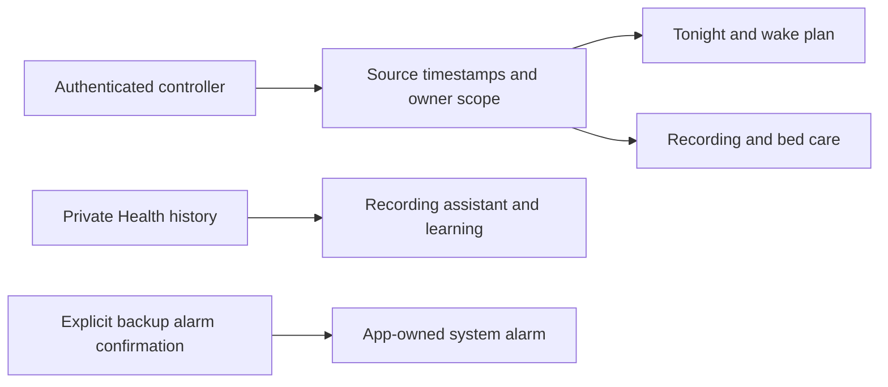

# Everyday controls release

This native release brings the approved Tonight overview, automatic comfort range,
Watch recording assistant, learning journey, clear wake plan and bed-care center
into one app revision. It preserves the encrypted owner offline library already on
main. The individual contract and validation records remain in this directory.

| Surface | Behavior | Remaining acceptance |
| --- | --- | --- |
| Tonight | Independently fresh mode, target range, actual wake occurrence and morning report entry | Live controller and distributed-app walkthrough |
| Comfort range | Reviewed automatic bounds with an explicit wake exception | Live policy acknowledgments and existing adaptation gates |
| Watch recording | Provenance-aware coverage, import receipt and permitted refresh opportunities | Actual Watch delivery and permission states |
| Learning | Separate stage, baseline and temperature readiness with useful next actions | Real data and reviewed learning gates |
| Wake plan | Canonical warm-up/vibration times, simpler editor, optional app-owned backup | Physical AlarmKit delivery and cancellation; accessories remain separate |
| Bed care | Five independent observations, expiring advice, diagnostic links and recovery guide | Live telemetry and physical maintenance/recovery |

## Validation record — 10 November 2026

- Signed iPhone simulator unit/model plus bed-care run: **1,244 passed, nine existing
  skips**, with no failures. This includes 1,242 unit/model tests and two care UI tests.
- Final iPad care run: **two passed**, including maximum Dynamic Type, diagnostic
  navigation and protection settings. Read-only inspection does not repair hardware.
- Latest signed iPhone offline-report navigation regression: **one passed**.
- Individual prior phone/tablet checks for comfort, Watch, learning, Tonight and wake
  remain documented in their parity records. Build-for-testing and strict lint pass.
- An earlier hosted iPhone offline run failed its Saved reports navigation assertion;
  a hosted iPad recording run failed accessibility-runner initialization. Their
  evidence is retained. The consolidated head must pass the hosted suites before
  merge; local passes do not erase those failures.
- Independent bed-care review accepted the resolved stale-advice, settings-link and
  product-contract findings after complete viewport and large-text recaptures.

These are source and simulator receipts, not TestFlight or physical qualification.
No Pod routine, live adaptation mode, side assignment or Apple Home pairing changed.

## Hosted suite grouping

The first consolidated iPhone run at `579aaa4` reached its 30-minute UI step
limit after six scenarios passed; no assertion failed before timeout. The iPad
runner separately failed to initialize Accessibility before executing tests.
Both failures remain in run 42936859716. The same selectors now run in recording,
guidance and wake groups on both device classes, with the existing 30-minute
per-step guard. `scripts/verify-everyday-ui.sh list <group>` makes the complete
selector inventory reviewable. No scenario or assertion was removed.

The first sharded iPad guidance job stopped before Xcode because macOS Bash 3.2
rejects an empty array expansion with `set -u`. Shared signing arguments now
keep that array nonempty. All six build/test invocations were verified through
a recording `xcodebuild` stub under `/bin/bash`; original selectors, signing and
time limits remain unchanged. This script check does not replace hosted UI tests.

## Menu readiness and return-scroll follow-up

The hosted iPad wake run at `2be8d83` attempted the Alarms menu item before its
presentation supplied a usable frame. The test now requires a finite, nonempty,
hittable menu element before tapping, retaining the navigation assertion and its
existing five-second bound. A focused local run then exposed a separate return-
scroll error: the offscreen Test vibration control was absent from SwiftUI's lazy
accessibility tree, so scrolling continued in the wrong direction. The helper now
uses the known return direction when no frame exists. Failure captures and the
accessibility tree are retained if either check fails.

All three affected scenarios passed on both signed iOS 27.2 phone and iPad
simulators: create/smart wake/snooze/test/Stop/pause/delete, regular editor, and
maximum-text editor. The first iPad local failure and hosted failures remain
retained. This changes test navigation only; it does not alter alarm UI, payloads,
scheduling or command authority. The separate hosted iPhone wake job stopped
before running any tests because its simulator destination became unavailable.
