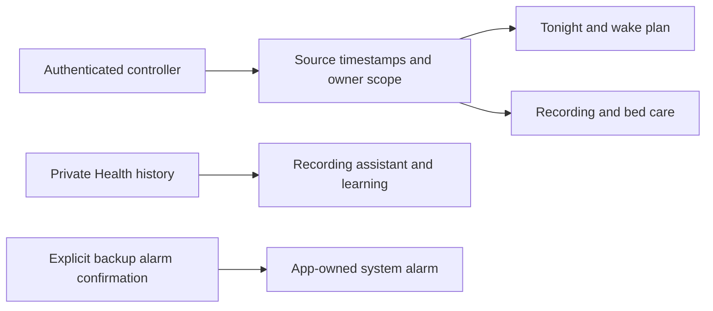

# Everyday controls release

This native release brings the approved Tonight overview, automatic comfort range,
Watch recording assistant, learning journey, clear wake plan and bed-care center
into one app revision. It preserves the encrypted owner offline library already on
main. The individual contract and validation records remain in this directory.

| Surface | Behavior | Remaining acceptance |
| --- | --- | --- |
| Tonight | Independently fresh mode, target range, actual wake occurrence and morning report entry | Live controller and distributed-app walkthrough |
| Comfort range | Reviewed automatic bounds with an explicit wake exception | Live policy acknowledgments and existing adaptation gates |
| Watch recording | Provenance-aware coverage, import receipt and permitted refresh opportunities | Actual Watch delivery and permission states |
| Learning | Separate stage, baseline and temperature readiness with useful next actions | Real data and reviewed learning gates |
| Wake plan | Canonical warm-up/vibration times, simpler editor, optional app-owned backup | Physical AlarmKit delivery and cancellation; accessories remain separate |
| Bed care | Five independent observations, expiring advice, diagnostic links and recovery guide | Live telemetry and physical maintenance/recovery |

## Validation record — 10 November 2026

- Signed iPhone simulator unit/model plus bed-care run: **1,244 passed, nine existing
  skips**, with no failures. This includes 1,242 unit/model tests and two care UI tests.
- Final iPad care run: **two passed**, including maximum Dynamic Type, diagnostic
  navigation and protection settings. Read-only inspection does not repair hardware.
- Latest signed iPhone offline-report navigation regression: **one passed**.
- Individual prior phone/tablet checks for comfort, Watch, learning, Tonight and wake
  remain documented in their parity records. Build-for-testing and strict lint pass.
- An earlier hosted iPhone offline run failed its Saved reports navigation assertion;
  a hosted iPad recording run failed accessibility-runner initialization. Their
  evidence is retained. The consolidated head must pass the hosted suites before
  merge; local passes do not erase those failures.
- Independent bed-care review accepted the resolved stale-advice, settings-link and
  product-contract findings after complete viewport and large-text recaptures.

These are source and simulator receipts, not TestFlight or physical qualification.
No Pod routine, live adaptation mode, side assignment or Apple Home pairing changed.

## Hosted suite grouping

The first consolidated iPhone run at `579aaa4` reached its 30-minute UI step
limit after six scenarios passed; no assertion failed before timeout. The iPad
runner separately failed to initialize Accessibility before executing tests.
Both failures remain in run 42936859716. The same selectors now run in recording,
guidance and wake groups on both device classes, with the existing 30-minute
per-step guard. `scripts/verify-everyday-ui.sh list <group>` makes the complete
selector inventory reviewable. No scenario or assertion was removed.

The first sharded iPad guidance job stopped before Xcode because macOS Bash 3.2
rejects an empty array expansion with `set -u`. Shared signing arguments now
keep that array nonempty. All six build/test invocations were verified through
a recording `xcodebuild` stub under `/bin/bash`; original selectors, signing and
time limits remain unchanged. This script check does not replace hosted UI tests.

## Menu readiness and return-scroll follow-up

The hosted iPad wake run at `2be8d83` attempted the Alarms menu item before its
presentation supplied a usable frame. The test now requires a finite, nonempty,
hittable menu element before tapping, retaining the navigation assertion and its
existing five-second bound. A focused local run then exposed a separate return-
scroll error: the offscreen Test vibration control was absent from SwiftUI's lazy
accessibility tree, so scrolling continued in the wrong direction. The helper now
uses the known return direction when no frame exists. Failure captures and the
accessibility tree are retained if either check fails.

All three affected scenarios passed on both signed iOS 27.2 phone and iPad
simulators: create/smart wake/snooze/test/Stop/pause/delete, regular editor, and
maximum-text editor. The first iPad local failure and hosted failures remain
retained. This changes test navigation only; it does not alter alarm UI, payloads,
scheduling or command authority. The separate hosted iPhone wake job stopped
before running any tests because its simulator destination became unavailable.

## Comfort editor viewport follow-up

The hosted iPhone comfort run at `2be8d83` passed the ordinary editor but its
maximum-text scenario did not observe the switch turning on. The retained video
and accessibility tree show a partly visible labeled row; they do not establish
a product switch defect. The test now requires the full control frame inside the
usable viewport before its single tap, with bounded bidirectional scrolling. The
existing five-second enabled-state assertion remains unchanged, and a failure
retains both a screenshot and the accessibility tree.

Both scenarios passed on signed iOS 27.2 phone (69.326 seconds) and iPad (47.251
seconds) simulators. All eight before-toggle/editor captures were inspected. No
production view or temperature behavior changed. This local result does not
replace the required hosted iOS 26 check; its original failure is preserved.

## Consolidated native source validation

The release branch includes the full ancestry of native PRs 60–66 and the
response-research feature, with recording/menu/comfort test repairs preserved.
The integrated source at `703b199ea503283db09f6d3fc4e6afebeb739816` passed 1,276
unit and transport tests on a signed iOS 27.2 iPad simulator, with zero failures
and nine existing live-service skips. The result bundle is
`SleepypodCombinedNativeUnits.xcresult`. Strict SwiftLint passed all 594 files.
Twelve macOS Bash 3.2 build/test script invocations preserved all six UI groups,
their selectors, signing settings and bounded execution. That script check is
not a substitute for hosted XCTest.

The final integrated source still needs the exact-head hosted checks. No new
TestFlight distribution, personal-data import, live controller switch or physical
qualification is asserted by these local tests.

## Care navigation viewport follow-up

The hosted iPad guidance run at `2be8d83` could not reach Status because its
settings sheet has a smaller visible scroll viewport than the application window.
The test now scrolls the containing view and requires a hittable point clear of
navigation chrome. It retains the bounded search, all destination assertions and
their original timeouts. Large-text disclosures at the bottom of a page need a
visible tap point rather than an impossible full-frame inset. No production view
or hardware behavior changed.

The final focused signed iOS 27.2 runs passed both care scenarios on phone
(123.487 and 59.304 seconds) and iPad (63.132 and 51.572 seconds). All fourteen
entry, care, recovery and protection-link captures were opened and inspected.
The hosted failure and three earlier local helper attempts are retained separately
from these final `SleepypodCareScrollPhone-v4` and `SleepypodCareScrollPad-v4`
receipts. Strict lint and whitespace checks passed for the helper.

## Learning navigation and import reconstruction

The retained hosted phone guidance failure at `2be8d83` reported the learning
entry as hittable while its center was above the navigation bar's visible edge.
The helper now requires a usable center point below navigation chrome and scrolls
in either direction, retaining its 35-attempt bound and ten-second destination
assertion. The regular and maximum-text scenarios passed on signed iOS 27.2 phone
(26.630 and 72.445 seconds) and iPad (20.331 and 40.404 seconds). All sixteen entry,
stage, temperature and refresh captures were opened. Earlier failures remain
separate receipts; no production view or learning behavior changed.

The pinned Free Sleep reconstruction check also exposed five existing Health
history changes missing from the integration overlay. The patch now reproduces
the current imported source exactly, without modifying either source checkout.
The broader dual-architecture test build exposed an overloaded numeric map in
`WatchComparisonTests`; explicit intermediate types retain the same 96 fixture
records and all assertions while removing unnecessary compiler inference work.
The complete simulator test build passed for arm64 and x86_64; all eleven Watch
comparison tests passed on the signed arm64 phone simulator. Reconstruction,
compiled-presentation, strict lint and whitespace checks passed. This is not an
x86_64 runtime result; the hosted Intel suite remains the runtime check.

## Reusable hosted test bundle

The everyday workflow now builds the signed simulator products once, then runs the
same six bounded screen groups on iPhone and iPad from that workflow's artifact.
Each consumer verifies the checked-out Git revision and Xcode version before
extracting the bundle. The selectors, test assertions, signing settings, boot
limits and 30-minute scenario-step limits remain unchanged. Failed result bundles
are still retained independently for every group.

A recording `xcodebuild` stub under macOS `/bin/bash` verified all twelve legacy
build/test invocations unchanged, all six shared-bundle selector/guard combinations,
the complete UI-test build selector and four invalid-input rejection cases.
`SleepypodRelocatedDaytime-v1.xcresult` confirms an archived, relocated arm64 bundle
actually ran the four off/empty/unavailable/unreadable states successfully (one
XCTest scenario, 35.781 seconds). This proves local relocation, not hosted Intel
compatibility or an observed CI speed improvement; the hosted workflow remains
an independent required check.

## Hosted interaction follow-up — 11 November 2026 UTC

Run 42965672278 at `6189c92` exposed three distinct test-navigation problems:
the iPad recording disclosure's activation point hit its diagnostics child;
bed-care scrolling used screen coordinates for a centered sheet; and cooling
scrolling could drag the temperature dial. The tests now target the visible
disclosure label and each actual scroll container's margin. A stable Status
identifier avoids relying on the accessibility label's punctuation. Phone sheets
retain their changing-detent swipe behavior and current content bounds.

The delayed cooling fixture no longer races a fixed 20-second sleep against a
slow hosted runner. A DEBUG-only, explicit demo action releases its suspended
reply after the test inspects the pending state. Cancellation resumes the wait
with an error. The fixture has no Pod transport, and the control is absent from
release builds. Pending controls must remain unavailable even when the state
report expires; no assertion permits repeating a mutation.

Both signed iOS 27.2 device classes passed all seven affected scenarios (bed care,
recording and cooling), 14 total, in `SleepypodEverydayRepair-iPhone-v5.xcresult`
and `SleepypodEverydayRepair-iPad-v5.xcresult`. The final generic arm64/x86_64
build and strict lint passed. The final pending-request assertion was rerun on
both devices in `SleepypodCoolingPending-iPhone-v6.xcresult` and the corresponding
iPad result: two passed. Original hosted and local failures remain retained.

The hosted iPhone response group separately passed all four scenarios, then
failed while GitHub's artifact service timed out five times. That upload failure
is not a failed response-model assertion, but the workflow still needs a green
exact-revision run before merge. No physical-device or deployed acceptance is
implied by these source and simulator results.
