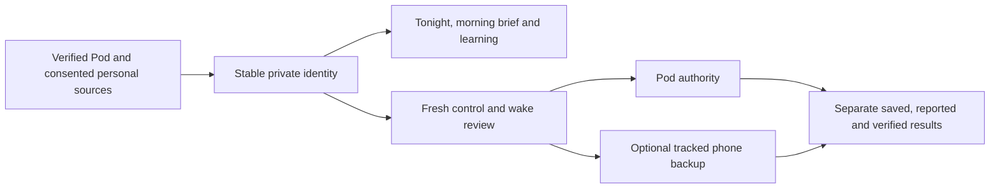

# Everyday app release — November 2026

This branch consolidates the approved everyday-app improvements into one mainline
candidate. It contains the original commits from PRs 60–64 and 66–68, plus the
one-occurrence later-wake review. A source merge is not a TestFlight or physical
qualification receipt.

## Resulting experience

- Tonight exposes the actual controller mode, comfort envelope, next wake and
  saved morning report; diagnostics remain available beneath everyday controls.
- Verified enrollment and approved local/remote routes preserve the same owner
  identity, private offline library, Health context and tracked phone backup.
  Recovery reads state and does not replay actuator requests.
- Recording health, Apple Watch import guidance and separate learning cards make
  missing observations and training evidence explicit. Observed target-response
  research remains separate from activated predictive control.
- Optional daytime activity and journal detail feed source-separated comfort
  comparisons. The morning brief presents three takeaways, a comparison and
  grounded follow-up, with the full report and evidence still accessible.
- Wake plans expose actual warming, vibration and one-occurrence restoration.
  Later waking previews the exact Core packet before saving; an optional app-owned
  phone backup has its own reviewed mutation and separately reconciled result.
- The overnight timeline distinguishes requested/reported values and withheld
  automation. Temporary cooling respects expiry, cancellation and newer manual
  intent. Bed-care guidance links real checks to appropriate next actions.

## Combined validation

The initial combined tree at `55cfaaa` passed build-for-testing, strict SwiftLint,
1,398 model/application tests with nine existing live-service skips, and both
phone and tablet morning-brief/later-wake smoke scenarios. The native later-wake
review then requested three bounded corrections: action-local errors, persistent
Pod-only restoration guidance, and current phone-alarm reconciliation.

The correction batch passed build-for-testing, strict SwiftLint and 1,400
model/application tests with the same nine skips. All nine later-wake UI scenarios pass on both phone and tablet. The
independent reviewer opened all 56 fresh originals, verified their hashes and
scored F1, F2 and F3 resolved; its ship disposition is limited to those findings. The first correction
build caught an optional date in a test fixture; the explicit unwrap corrected it.
The original failed build log remains retained.

Local evidence uses Xcode with the iOS 27.2 simulator. Hosted iOS 26 build, contract,
comfort, offline, personal-context and everyday-UI gates must pass on the final
combined head before merge. Earlier branch checks do not substitute for that run.
The earlier PR 64 phone-run failures occurred before tests during simulator AX
startup; those failed receipts remain retained.

## Acceptance still separate

This candidate makes no claim of a newly deployed Pod, TestFlight distribution,
actual AlarmKit alert, remote gateway deployment, work-VPN/cellular access,
prospective comfort benefit, household activation or accessory qualification.
No real Pod, phone, Health, provider or household settings were changed during
these simulator checks. The active 70°F overnight preference, weekday 07:00 wake,
06:30 warm-up toward 105°F and 20-second vibration remain outside this source
release operation. Fresh attended availability is required before a live restart.

See the feature-specific records in `Integration/parity/` for contract boundaries,
source fixtures, independent design review and validation history.
