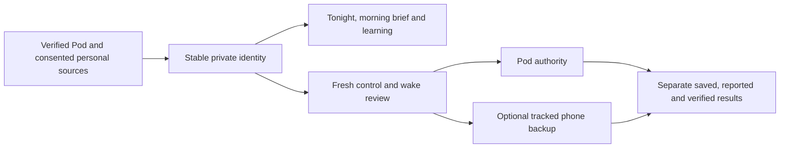

# Everyday app release — November 2026

This branch consolidates the approved everyday-app improvements into one mainline
candidate. It contains the original commits from PRs 60–64 and 66–68, plus the
one-occurrence later-wake review. A source merge is not a TestFlight or physical
qualification receipt.

## Resulting experience

- Tonight exposes the actual controller mode, comfort envelope, next wake and
  saved morning report; diagnostics remain available beneath everyday controls.
- Verified enrollment and approved local/remote routes preserve the same owner
  identity, private offline library, Health context and tracked phone backup.
  Recovery reads state and does not replay actuator requests.
- Recording health, Apple Watch import guidance and separate learning cards make
  missing observations and training evidence explicit. Observed target-response
  research remains separate from activated predictive control.
- Optional daytime activity and journal detail feed source-separated comfort
  comparisons. The morning brief presents three takeaways, a comparison and
  grounded follow-up, with the full report and evidence still accessible.
- Wake plans expose actual warming, vibration and one-occurrence restoration.
  Later waking previews the exact Core packet before saving; an optional app-owned
  phone backup has its own reviewed mutation and separately reconciled result.
- The overnight timeline distinguishes requested/reported values and withheld
  automation. Temporary cooling respects expiry, cancellation and newer manual
  intent. Bed-care guidance links real checks to appropriate next actions.

## Combined validation

The initial combined tree at `55cfaaa` passed build-for-testing, strict SwiftLint,
1,398 model/application tests with nine existing live-service skips, and both
phone and tablet morning-brief/later-wake smoke scenarios. The native later-wake
review then requested three bounded corrections: action-local errors, persistent
Pod-only restoration guidance, and current phone-alarm reconciliation.

The correction batch passed build-for-testing, strict SwiftLint and 1,400
model/application tests with the same nine skips. All nine later-wake UI scenarios pass on both phone and tablet. The
independent reviewer opened all 56 fresh originals, verified their hashes and
scored F1, F2 and F3 resolved; its ship disposition is limited to those findings. The first correction
build caught an optional date in a test fixture; the explicit unwrap corrected it.
The original failed build log remains retained.

Local evidence uses Xcode with the iOS 27.2 simulator. Hosted iOS 26 build, contract,
comfort, offline, personal-context and everyday-UI gates must pass on the final
combined head before merge. Earlier branch checks do not substitute for that run.
The earlier PR 64 phone-run failures occurred before tests during simulator AX
startup; those failed receipts remain retained.

### Hosted cooling follow-up

The combined hosted run exposed an iPad cooling-cancellation failure at maximum
text size. The panel used the preceding TimelineView tick to validate a newer
network reply, briefly treating the active cooling lease as future data and
replacing its Cancel action. Validation now uses the current render clock;
future timestamps and the existing freshness limit remain rejected by the model.
The UI check explicitly waits for cancellation and verifies that Cancel disappears.

The correction passes build-for-testing, strict SwiftLint, all 14 temporary-cooling
model tests and all three cooling UI scenarios on both iPad and iPhone. These
cover maximum text size, delayed operations and unconfirmed replies. The tablet
maximum-text-size capture was inspected for wrapping and scrolling. This local
evidence uses Xcode 27.2; the final hosted iOS 26 run remains a separate gate.

Hosted attempts also reported that macOS runners were not acquired because of
capacity constraints. The matrix now requests at most two runners concurrently,
retaining all 18 form/suite combinations, their shared exact-revision bundle and
existing timeouts. This limits demand; it does not count an unacquired job as a pass.

## Acceptance still separate

This candidate makes no claim of a newly deployed Pod, TestFlight distribution,
actual AlarmKit alert, remote gateway deployment, work-VPN/cellular access,
prospective comfort benefit, household activation or accessory qualification.
No real Pod, phone, Health, provider or household settings were changed during
these simulator checks. The active 70°F overnight preference, weekday 07:00 wake,
06:30 warm-up toward 105°F and 20-second vibration remain outside this source
release operation. Fresh attended availability is required before a live restart.

See the feature-specific records in `Integration/parity/` for contract boundaries,
source fixtures, independent design review and validation history.

## Private check-ins and comparison consolidation

The integrated candidate includes the private editor from PR 71 and the saved
check-in comparisons from `be0094e`. Comparisons pin the account and revisions,
exclude unsaved and legacy content, retain the original time zone, and explain
usable counts and association limits. The independent reviewer scored the
expanded Dynamic Type finding resolved after the complete result block received
intrinsic vertical sizing.

The product source at `cd472dd` passes all 1,472 app/framework checks with nine
existing live-service skips and the phone export-cancellation UI scenario. The
same built product passes seven iPad checks: all six household maintenance cases
and export cancellation. Strict SwiftLint passes. Separate final-source habit
comparison evidence covers all four scenarios per device across split runs,
including the restarted iPad's largest-text and landscape check.

Hosted video from the previous revision shows Files still blank at video second
44, then the actual Save control at second 50, after the ten-second assertion had
expired. The test now allows thirty seconds for that same visible, hittable Save
control, captures the result before asserting, and still explicitly cancels and
requires no export-success receipt. No production export behavior was changed.
The separate hosted maintenance failure occurred before tests while waiting for
the simulator accessibility service. Original failures are preserved.

The enlarged hosted UI coverage builds all four recording/learning/journal suites
once, runs each once per device in separate steps, and retains all four result
bundles. Existing recording and learning checks retain their assertions; the new
journal and habit checks get distinct reports. This is coverage organization,
not proof of hosted success. Final hosted checks and distribution remain pending.

## Household confirmation harness correction

The hosted iPhone job at `cd65ca9` reached the tests and reported an unchecked
separate-activation confirmation after its coordinate tap. It later exhausted
the combined three-suite step's 20-minute limit. Its original log and artifact
are retained; the interrupted result bundle lacks its final `Info.plist`.

The review harness now scrolls through the label column, locates the contained
native switch, checks that each confirmation starts off, and waits for its
selected value after one explicit tap. It rechecks all three after scrolling
before testing approval. These changes match the existing maintenance harness;
no production approval, freshness or activation rule changed.

All twelve maintenance/review/preparation scenarios pass on both signed local
iPhone and iPad simulators, with no failures or skips, including the lost-reply
case and maximum-text confirmations. Build-for-testing, strict SwiftLint and
the workflow selector audit pass. Hosted execution remains required.

The workflow builds once and runs all three original suites in separate bounded
steps, retaining each result bundle even when another suite fails. Each step
retains a 20-minute limit and the overall job retains its 65-minute limit; no
scenario or assertion was removed.
