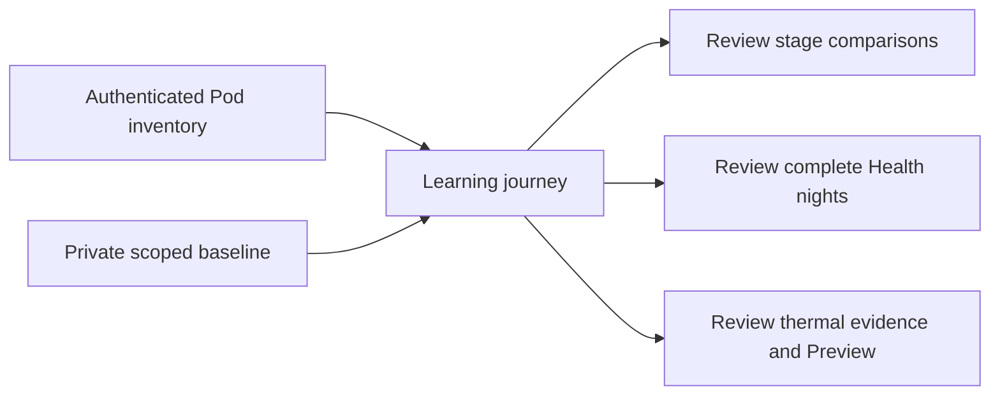

# Guided learning journey

Approved improvement 07 adds a readable path from Sleep, its offline library and
Status to three separate kinds of learning. Existing detailed model and training
screens remain reachable from the relevant card.

The overview performs model-inventory reads only. It does not read Health, train,
select an estimator or enable temperature adaptation. Opening the private baseline
loads its existing scoped artifact; its original-source refresh remains explicit.
Demo mode uses examples and cannot inspect the owner's local baseline. Personal
preparation does not show household-owner models.

The Pod side selector controls stage inventory and thermal checks. Watch-based
stage training explicitly uses the user's usual side; it cannot silently relabel
Watch data for the other side. The personal baseline belongs to the iPhone's Health
source, independent of the selected Pod side. Counts represent the existing reviewed
selection, not proof of model validity or improved sleep.

Inventory expires after five minutes and is withdrawn during refresh, failure,
side/account changes, cancellation or disappearance. Each independent read can
succeed even if the other fails. Version, side, counts and available source timing
are validated. Saved baseline verification expires with its existing 45-day rule.
No new persistence, cloud sharing or hardware command authority is introduced.

Native and web journeys use the same three purposes and evidence distinctions.
Physical model delivery, accuracy and prospective comfort outcomes remain separate
from software validation.

## Validation — November 10, 2026

The signed iPhone run passed 19 tests: nine learning-state regressions, existing
personal-comfort transport and Pod-stage checks, and two UI flows. The two UI flows
also passed on iPad. Dark/light and accessibility extra-extra-extra-large layouts
were reviewed. Strict SwiftLint passed. A separate UI check pins the usual side to
Left while selecting Right for temperature review, preventing cross-test settings
from hiding a side-routing regression. No physical-device test or release is implied.
