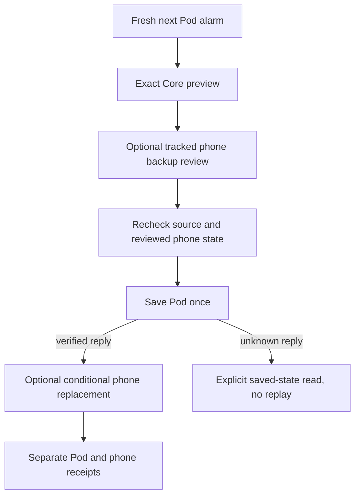

# One later wake on iPhone and iPad

Approved improvement 15 extends the existing occurrence alarm card with an inline
review, rather than modifying the weekly schedule. Core PR 98, merged as `0933e901b87011f2dcbf9adaadb1b88da8e54718`, supplies the
revision-checked, expiring preview and atomic Pod application. The optional phone
step uses this app's tracked AlarmKit backup; it cannot edit other Clock alarms.

## Contract and scope

- `LaterWakePacket` keeps the entire reviewed JSON, including explicit nulls, and
  returns that exact object to Core. Native validation checks source, dates,
  timezone, temperature, vibration duration, wake window, warm-up/hold intervals,
  expiry and unchanged weekly schedules. Unsupported controllers do not fall back
  to a different mutation route.
- A packet expires within 90 seconds or when original warming begins. A new time,
  changed account, unavailable read, concurrent plan edit or background transition
  withdraws application. An unknown Pod reply requires an explicit read; no request
  is replayed and a draft is never silently rebased.
- The optional phone step starts unchecked. Its reviewed state is either no
  tracked app alarm or the exact same person's, same side's, same occurrence's
  verified system alarm. It is checked before the Pod save and again before and
  after requesting phone permission. Another alarm is never removed speculatively.
- Only a verified Pod save permits a phone write. A denied permission, missing
  system receipt, changed phone alarm or interrupted response yields a partial
  result. The Pod is not rolled back. A durable phone receipt permits subsequent
  read-back/cancellation without duplicating an alarm.
- Replacing a phone backup removes the old tracked alarm first; the review states
  that failure can leave no phone backup. Restoring the Pod separately leaves the
  phone alarm unchanged and says so explicitly. Both are one-occurrence changes;
  this does not create a recurring phone schedule.
- Lights, shades, audio and other Clock alarms remain outside this mutation. Pod
  persistence, timer registration, iOS scheduling and physical delivery remain
  separate claims. All test/demo data is synthetic and uses no live transport,
  durable personal data, OS alert or household command.

## Source-generated fixtures

`Integration/Fixtures/later-wake-example.json` is exported by
`scripts/export-later-wake-fixture.mjs` from Core's isolated SQLite fixture/store at
`63d0642846d3de062c7230ab27181302fdb9831f`. Ordinary, movement-window and Pod-timezone
cases contain before, preview, saved and restored states. Scheduler acknowledgment
is deliberately false. The simulator examples translate these timestamps together
and use memory-only companion alarms; they are not an independent schedule policy.

## Validation

- Initial foundation: 37 focused model/workspace/REST/phone-backup tests pass.
- Coordinated mutation foundation: 44 focused tests pass. The final full model and
  application suite passes 1,388 tests with nine existing live-service skips
  (`/tmp/SleepypodLaterWake-units-v5.xcresult`).
- Native build-for-testing and strict SwiftLint of changed application files pass.
- Initial phone and tablet runs each passed five of six scenarios and exposed a
  time-driven expiry display issue. Source validation already blocked expired saves;
  the child view now receives the timeline date so its status updates too. Visual
  inspection also corrected the inverse Save-label color and stacked quick choices
  at accessibility text sizes. All six corrected UI scenarios pass on both phone and tablet. Test-only capture
  positioning reruns also pass on each device (restoration v6; phone review v7).
  The initial 40 originals and full review are retained in
  `.impeccable/review/later-wake-native-initial-review/`. CI includes a separate
  bounded `later-wake` group on both devices.
- The independent full review requested three corrections: action-local preview
  errors, persistent Pod-only restoration guidance and current phone-alarm
  reconciliation. The bounded correction passed 1,400 model/application tests
  with the same nine skips and all nine UI scenarios on each device. The reviewer
  opened all 56 fresh captures in `.impeccable/review/later-wake-native-finish/`
  and scored F1–F3 resolved (ship at that scope). Physical VoiceOver announcements
  and real system alarm delivery were not exercised.

No physical Pod or iPhone was changed. There is no TestFlight delivery claim.
