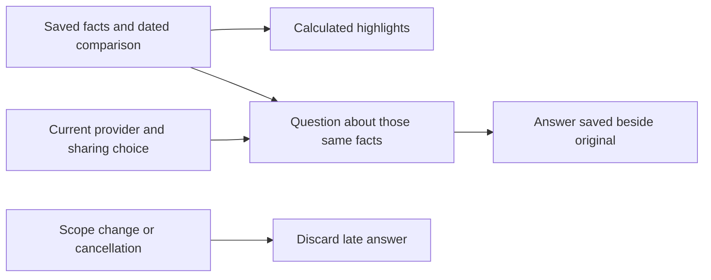

# Morning brief and questions about saved evidence

The existing Tonight morning entry now presents up to three calculated highlights
and a small recorded-sleep comparison before opening the full brief. The original
report renderer and its evidence disclosures remain available. This extends the
native design without replacing the existing reports screen.

## Evidence contract

New reports that explicitly include Health facts retain an optional, immutable
14-day comparison snapshot from the selected source. It stores the import date,
request date, source identity and timezone with the report in the existing
device-local encrypted archive. It is not sent as raw Health samples to a provider.

- A day is noon to noon in the recorded timezone, preserving actual DST lengths.
- Values are recorded source estimates and may include naps or partial nights.
  They are not confirmed complete nights or measured sleep quality.
- Absent days remain gaps. No interpolation, zero fill or stitching across sources.
- Exact duplicated records count once; conflicting records or ambiguous buckets
  are excluded. Future, impossible and not-yet-imported observations are excluded.
- Recent/prior seven-day medians require at least four observed days in each
  period. A difference is descriptive, not evidence that a treatment worked.
- Invalid saved chart metadata is withheld. Older reports retain their original
  facts and text; chart values are never extracted or guessed from model prose.

The brief always states when the evidence was saved. Viewing it does not import
Health, call a model or imply a fresh analysis of last night. The optional
experiment comes from the report's actual, explicitly named singular proposal;
its evaluation instructions and evidence links remain together. New report
requests ask for that section only when the supplied facts support a proposal.
Missing, ambiguous or oversized sections remain in the full report instead of
being guessed or truncated into a different recommendation. Bed settings and
wake alarms are preserved. Controlled comfort experiments remain a separate
workstream.

## Follow-up questions

Questions use exactly the original report's calculated facts. They do not include
later Health history, other reports, the previous model's interpretation or raw
samples. The same model picker, provider keys and per-device request limit apply.
Cloud/local-server transmission requires fresh, per-question consent. Apple local
generation remains on-device when available.

Answers retain their question, provider, model, date and provider-reported usage
beside the original report, with a maximum of ten answers per report. They use the
existing rendered-prose/evidence component. Original text, facts and creation time
stay unchanged. Account, source-scope or model changes, cancellation, device lock,
backgrounding and deletion invalidate a late answer. An unreadable archive is not
overwritten. Demo practice never sends a request or reads personal data.

## Validation

The final signed arm64/x86_64 simulator build and strict SwiftLint pass. The
complete model/application suite passed **1,380 tests**, with nine existing
live-service skips and zero failures (`SleepypodMorningBriefUnits-v11.xcresult`).
Behavioral coverage includes missingness, DST, source separation, conflicting
records, legacy decoding, experiment extraction, consent, cancellation, deletion,
locking and identity changes.

The final iPhone UI run passed all four walkthroughs. iPad passed three in v11
and its normal walkthrough in the focused v12 run. The v11 iPad failure was a
capture-harness boundary: the final paragraph midpoint was four points outside
an artificial inset, although it was visible. The harness now uses that
paragraph's actual visible safe area; app layout did not change. Earlier failed
harness receipts are retained, including combined accessibility labels and a
maximum-text question capture that had scrolled past the field.

The review packet contains 58 original captures across phone and tablet: dark
and light, normal and maximum text, complete/sparse/missing comparison, missing
experiment, expanded evidence, active keyboard, sharing destination and saved
follow-up. Builder inspection is complete; independent finish review is pending.
The extension preserves the incumbent Theme, system typography, navigation and
report components. No new design system or HTML/CSS detector is involved.

All example data and example answers are synthetic. No real Health import,
AI-provider request, physical iPhone, TestFlight release, Pod action or accessory
action occurred. Local Xcode 27.2 results and hosted Xcode 26.3 checks are separate
release evidence.
