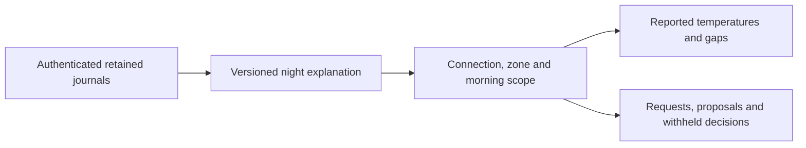

# What happened overnight?

Approved improvement 13 extends Tonight with a read-only history for a physical
zone and selected morning. It preserves the app's native typography, semantic
colors, scrolling, date picker and disclosure controls. The chart separates
reported water temperature from the powered target and breaks lines at missing,
reordered or more-than-90-second gaps. Neither series is body temperature or sleep.

Controller receipts, personal Preview decisions and rule logs have distinct
labels. Original room report clocks and cached values remain visible. A source
failure is independent of other sources. Opening this view cannot issue a hardware
command, start a controller or infer who operated a household accessory.

The owner-only REST reader validates the response before presentation. A failed
refresh withdraws old evidence; a connection, account, zone or morning change
invalidates in-flight results. Reports expire after five minutes. Backgrounding
and leaving the screen invalidate its workspace. Personal credentials cannot
reuse owner history. Household attribution and house-command receipts remain
separate workstreams.

## Shared source fixture

`Integration/FixtureGenerators/generate-night-explanation.ts` runs the actual Core
reader over migrated, in-memory synthetic journals. It requires a clean Core
checkout and records the source commit. Use Core's `tsx` with
`--tsconfig <core-checkout>/tsconfig.json` so its own path aliases resolve, then
pass the clean checkout path as the generator's first argument. The result is
`Integration/Fixtures/night-explanation-example.json`.

Four examples cover left/right and 23-/25-hour DST windows. The normal demo view
uses those labelled synthetic journals without a network transport and rejects
unsupported mornings. The DEBUG unavailable scenario tests recovery without
showing old evidence.

## Validation

The source-generated contract passed eight signed iPhone simulator tests,
including malformed clocks and identities, unavailable reads, selection changes,
late replies after cancellation, chart gaps, DST and the read-only REST request.
The full signed iPhone run passed 1,267 tests with nine existing skips, covering
the app, shared FreeSleepKit framework and three night-history UI scenarios.
Build-for-testing and scoped strict SwiftLint passed. Eight focused model tests
also passed on iPad. Final three-scenario UI suites passed on both iPhone and iPad
after the last visual correction; they exercise all four event filters, selected
accessibility values, 44-point minimum filter height, disclosures and unavailable
recovery.

The first visual inspection found overlapping maximum-Dynamic-Type chart labels.
Adaptive height, fewer clock ticks and edge-anchored labels correct that layout.
An iPad interaction run exposed a history row whose blank center was not tappable;
a full-row content shape corrects the actual hit area. That intermediate iPad run
passed 1,157 tests with two UI failures and nine skips; the original failed result
remains in the local evidence. The final phone regression passed after both fixes.

The fixture was regenerated from the later Core documentation commit and all four
cases matched the pinned functional-source fixture exactly. Hosted CI remains separate
from local XCTest results.

All 26 final captures were opened individually: phone and tablet overview, window,
chart, filtered events, room reports and aggregate sources at default Dark and
maximum-Dynamic-Type Light appearances, plus unavailable recovery. The independent
finish review found one additional material issue: the closed event-filter label
clipped at maximum type on iPhone. A multiline native Menu label corrects it.
The finish reviewer scored F1 resolved; disposition ship for that fix. This is a
scoped verdict, not a new whole-surface audit. The incumbent Theme is preserved.
No HTML/CSS detector was used for SwiftUI.

Screenshots, the original review, scoped verdict and final run logs are archived
with SHA-256 hashes in the private diagnostics folder
`2026-11-10/night-explanation/native`. Expanded individual-event source details,
loading/all-empty renders, pagination, VoiceOver traversal, increased contrast,
landscape and split-screen remain outside this captured review. Earlier failed
iPad interaction and capture-harness runs remain retained separately.

These receipts do not establish TestFlight distribution, actual Pod journals,
physical temperature effects or household command attribution.
