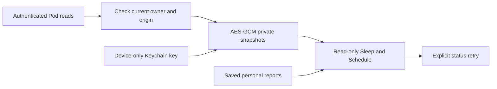

# Offline reading

Part of approved platform improvement 02. This change implements the installation
owner's private offline library. Personal accounts now have a separate
[saved-readings implementation](../../docs/PERSONAL_OFFLINE_LIBRARY.md) for their
own downloaded records and operating week; they never borrow the owner's data or
report archive. Saved weeks do not constitute publication or alarm receipts.

Sleep and Schedule now remain useful when the controller disconnects. The app saves
30 days of bed recordings on each side and the complete last-confirmed weekly
schedule, including Core's individual power, temperature and alarm rows. Saved
personal reports open locally with their existing formatted evidence renderer.

Each section carries its own successful-read timestamp. A partial refresh preserves
the previous section and timestamp; it does not label stale data as new. Recording
windows retain gaps and fractional-second boundaries. Open records never grow while
offline, and recorded bed presence is not presented as measured sleep.

## Storage and lifecycle

- AES-GCM authenticates both ciphertext and its namespace/scope. Files from another
  account or origin cannot be substituted, even when copied to the expected path.
- Keys use `WhenUnlockedThisDeviceOnly`; files have complete file protection and are
  excluded from backup. There is no plaintext fallback when Keychain is unavailable.
- The owner library is bound to backend, exact origin and credential revision. An
  account change withdraws visible data synchronously; delayed old replies are ignored.
  Personal workspaces cannot read the owner library or the owner report archive.
- Authentication rejection removes the saved controller copy. Ordinary network
  outages retain it. The user can remove the current Pod copy from the offline menu.
- Existing report archives migrate locally: encrypt and write atomically before
  removing the old protected JSON. Failed encryption preserves the old archive.
- Background/locked Keychain failures do not weaken protection. A later foreground
  restore retries the read. No network request or AI generation is needed to view a
  saved report.
- Offline views contain no bed actions or editors. Refresh and reconnect are reads;
  nothing is queued for later execution. A saved schedule is not a receipt proving
  an alarm will physically fire or showing a later one-time override.

The encryption primitives and key accessibility follow Apple's
[CryptoKit AES-GCM](https://developer.apple.com/documentation/cryptokit/aes/gcm)
and [Keychain accessibility](https://developer.apple.com/documentation/security/restricting-keychain-item-accessibility)
APIs.

## Validation

Targeted tests cover encrypted round trips, tampering, cross-scope file substitution,
locked-key write failures, archive migration/recovery, account changes before view
tasks run, delayed responses, authentication rejection, independent freshness and
zero actuator writes. UI fixtures cover offline records, reports, schedule rows,
side selection, large text and reopening after termination without fetching.

Unsigned simulator test runners cannot access Keychain (`-34018`), so storage unit
tests inject ephemeral test keys. The UI persistence test must run with simulator
signing enabled and exercises the actual Keychain implementation. Synthetic fixture
screens are not physical-device or TestFlight evidence.

On 10 November 2026, the signed iPhone simulator run passed 1,177 tests with nine
existing live-hardware tests skipped. This includes all unit/transport regressions
and the four offline UI cases. The iPad run passed all four offline UI cases.
Both forms passed the actual Keychain persistence test after app termination,
including a second launch which cannot fetch records. SwiftLint strict and
`git diff --check` passed. The simulators ran iOS 27.0; CI also exercises iOS 26
on both forms. Local result bundles are `sleepypod-platform-regression.xcresult`
and `sleepypod-offline-ipad.xcresult` in `/tmp`.

This change has not yet been distributed through TestFlight. A real disconnected
phone/iPad walkthrough remains pending. Personal-account source validation and
release evidence are tracked separately in the linked saved-readings document.
