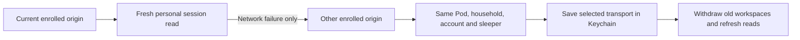

# Personal home and away connections

Each personal account can enroll a home origin and an HTTPS remote origin in
Account → Home and away. Both must be entered and reviewed before the personal
device key is sent. This uses the account's existing device key; it never reads
the installation-owner key or broadens personal capabilities.

The two origins must return the same validated personal session. Verification
reads `GET /api/v1/household/session?challenge=<32-byte-base64url>` and requires
the matching `X-Sleepypod-Connection-Challenge` response header. Old Core
installations keep ordinary personal access but cannot enroll automatic routes.
The optional challenge is implemented in Core's household HTTP handler.

Foreground activation, network changes and a 30-second foreground check recover
reads. TLS, HTTP authentication, malformed replies and different identities do
not permit fallback. Secure-storage failure keeps the previous selected origin.
Account selection, sign-out, backgrounding and cancellation invalidate late
results. A changed session or assignment triggers a full personal refresh.

Unknown command/publication receipts and private drafts remain in the account
vault. Route recovery never invokes their mutation/retry methods. It does not
replay bed, audio, routine or alarm actions. Existing account and maintenance
guards still apply; arrangement maintenance does not switch transport mid-step.

Verified pairs retain the original encrypted offline-library namespace. The
profile binds it to the original connection ID, device-key digest and all four
personal identity fields. An arbitrary address, replacement key or different
person cannot reuse that namespace. Turning automatic recovery off retains this
verified storage mapping while stopping network fallback.

The screen does not provision a gateway or VPN. A private remote origin must
already be reachable and forward authentication, challenge queries and response
headers without caching or redirecting them. Cellular/work-VPN operation,
real-device background behavior and deployment are separate acceptance checks.

Validation lives in `PersonalRouteTests`, `PersonalRouteTransportTests`,
`HouseholdRouteRecoveryTests`, the existing offline/account suites and
`PersonalRouteUITests`. Simulator fixtures never contact a real origin.
