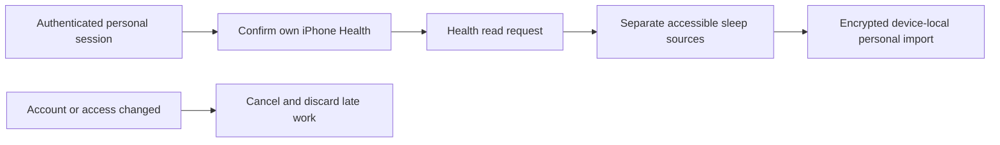

# Personal-account Health enrollment

11 November 2026. Core capability [PR 117](https://github.com/lucaandrea/sleepypod-core/pull/117)
merged after all hosted checks as `5746726db3b900a1723b13b2f231eb9ec03b14d1`.
Its tree matches tested `9d819b160f1ad79a771ed9788edcdf2447ad7213`; main
package, release, OpenAPI, ref and back-merge workflows all passed.
This adds read-only enrollment and imported-history storage for
the person authenticated in the household workspace. Distribution and real-device
Health acceptance remain pending. It does not activate shared-bed arrangements,
copy owner reports/models, enable personal cloud analysis or retrain a model.

## Ownership and consent

The authenticated Pod, household, account and sleeper UUIDs own the import.
Physical side, display name, connection URL and session revisions do not own it.
One physical Health library has one explicit personal-account enrollment on this
device. A second account sees no existing identity, history, source names or dates;
it cannot overwrite or remove the first account's import from its Health page.
An explicit local-personal-data erase can remove the old link, including an
unreadable archive. This is not a Health-profile detector: the person must confirm
that the iPhone's records are their own.

The initial action requires a current authenticated session, the controller's
`healthImport` capability and explicit confirmation. Only then may it request
HealthKit read permission. Older Core sessions advertising false do not expose
the enrollment entry. Successful permission requests are not described as proof
of read access: Apple intentionally does not reveal whether reading was denied.
See [Apple's authorization documentation](https://developer.apple.com/documentation/healthkit/authorizing-access-to-health-data).

## Data and lifecycle

- Consent, stable identity, selected source, refresh preference and imported
  history share one atomic encrypted record. The device-local encryption key is
  available only while unlocked and is not transferred in a backup. The data
  directory is excluded from backups and files use complete file protection.
- The owner archive, provider keys and owner model stores are never read or
  migrated by this flow. Personal imports are not sent to Core or a model provider.
- Imports reuse the existing paged Health reader: all accessible sleep history,
  separate sleep sources, Watch provenance, and daily vital averages. Daily vital
  averages may combine Health sources and are not sleep-only measurements. A
  recorded noon-to-noon day is not automatically a complete training night.
- Account, credential and assignment revisions invalidate ongoing work. A
  confirmed new session for the same stable person can reopen their old import.
  A cached identity may read its saved copy during an outage; new enrollment and
  imports require the live session. Backgrounding, locking, logout and revocation
  hide data and cancel reads. Revocation removes only the matching personal import.
- Revision comparisons prevent late imports from restoring deleted/re-enrolled
  data. Corrupt storage cannot be silently replaced. Failed reads preserve the
  previous import; successful empty reads withdraw prior returned records and
  explain the records-versus-permission uncertainty.
- Optional refresh runs when the personal account is opened/foregrounded, with
  morning and daytime intervals. No background-delivery guarantee is implied.
  New personal model training, reports, daytime context, server Health upload and
  reviewed legacy-owner transfer remain separate unfinished workstreams.

The page extends the existing native detail-page typography, spacing, controls,
colors and light/dark behavior. No new visual identity or design tokens are added.
The DEBUG UI fixture uses temporary encrypted files and an ephemeral test key;
HealthKit, Keychain, Pod requests and model providers are not invoked.

## Validation record

The latest complete model/application regression passed 1,543 tests with nine
existing skips. Focused checks cover explicit consent, account isolation, cached
reading during an outage, credential/assignment changes, locking, cancellation,
late callbacks, deletion/re-enrollment races, corrupt storage and source validation.
The six Health UI scenarios passed on both signed iPhone and iPad simulators.
An initial cancellation lookup queried a progress indicator; the actual native
accessibility tree exposes an activity indicator. Correcting that selector keeps
the cancellation, retained-history and busy-state assertions intact.

The first rendered accessibility review found labels reaching the capsule edges
at the largest text size. Health actions now reuse the existing padded report
sharing treatment through `FeatureActionButtonStyle`, with the report's behavior
unchanged. Final shared-style regression checks pass all 22 UI cases (six Health
and five report-sharing scenarios on each device class), with no skips. The
corrected top-of-page capture reran the largest-text case successfully on both
devices. The independent review then identified a clipped selected-source label at the
largest iPhone text size. A wrapping native menu label fixes it without reducing
Dynamic Type. The complete Health UI suite now passes seven scenarios on each
device, including short/long source switching and distinct coverage. The same
reviewer scored that finding resolved from the final captures. These are simulator
results; hosted checks, TestFlight distribution and actual Health-device
acceptance remain open.
