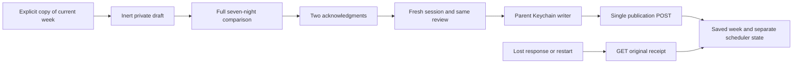

# Personal routine review and publication

Contract: Core PR69, immutable merge `cccf671b78cbab4fd3dbb1a49e34adc4cde2b744`, `docs/PERSONAL_ROUTINE_API_V1.md`. `Integration/Fixtures/personal-routines-v1.json` is copied byte-for-byte. This is a native implementation and verification gate, not a Pod deployment or TestFlight release. Version remains 0.4.2 (15).

## Draft and review boundaries

Saving personal routine drafts stays inert. Publication requires the optional `personalRoutinePublication` capability to be explicitly true. Missing/false capability never opens publication. Own historical receipt lookup remains available after a side move or capability removal.

The weekly editor explicitly copies the actual operating week after confirmation; it never substitutes profile defaults. Copying, removing a night and clearing the draft do not publish. Empty drafts survive navigation return. Reloading saved drafts requires confirmation even when the revision is unchanged; newer server revisions preserve local edits and require review before another draft save. All power, phase, wake-window, vibration, snooze, end-action and note fields round-trip. Custom snooze seconds remain visible without rounding them down to minutes.

The publication screen compares all seven bedtime nights, including additions, replacements, removals and unchanged nights. Expand a night for the entire before/after routine. Wake and end times identify the following calendar morning when appropriate. Pod timezone, affected thermal zones and the one scheduled-vibration source remain explicit. Both acknowledgments reset whenever the review is refreshed or changed.

## One publication and durable recovery

The client rechecks the personal session and complete review immediately before publication. Identity, assignment, configuration, timezone, live and draft revisions and every reviewed field must still match. The exact short-lived request is retained in Keychain before its sole POST, using dedicated fixed personal endpoints without owner fallback, cookies, cache or redirects.

Every sent request remains recoverable, including HTTP failures: a rejection after scheduler refresh can follow an already-committed week. A lost response or 404 is not proof of no save. Reconciliation only GETs the original own-account receipt; it never resends or creates another publication. Saved week, scheduler pending/refreshed/unconfirmed and physical verification remain separate states. Unresolved controls and publications block ordinary changes across both workspaces while Stop remains available. Controller recovery is a separate gate; republishing is not a repair action.

The parent workspace remains the only Keychain writer and merges updates into the latest record. Control attempts, publication attempts and their recovery references share a 64-unresolved reservation limit, checked before POST; no unresolved evidence is silently evicted. Completed publication history retains the latest 30 receipts. Revocation erases the credential, private week and request body, retaining only verified identity, request ID, expiry and unresolved state. Only an explicit fresh pairing of the same account can read that receipt. Erasing all local personal data also removes these references.

## Verification boundary

Frozen-contract, transport, vault and lifecycle tests cover exact request persistence, full-week deletion, custom alarm preservation, stale scope/hash/timezone/draft, post-commit failures, missing/pending/unconfirmed receipts, account changes during awaits, historical receipts after side movement, revocation/re-pair isolation, shared capacity and explicit erase. UI fixtures use only an in-memory actor and vault; they cannot reach live hardware. iPhone/iPad scenarios cover full fields, both acknowledgments, receipt recovery, maximum Dynamic Type, current-week import, cancelled reload and an intentionally cleared week.

A separate follow-up control fix advances a local epoch when Stop begins, preventing an ordinary action or publication still awaiting preflight from posting afterward. It does not cancel already-sent requests, erase future saved routines or claim physical Stop success. Regression checks cover both Power off and Stop vibration, cross-workspace publication preemption and the already-sent cases. Ordinary adjustments require fresh water-OK/non-priming observations at both UI eligibility and final preflight; Stop remains available under the current authority.

Assignment activation, private history, Apple Health and physical qualification remain separate gates. No live schedule, temperature, alarm, runtime flag, Pod deployment, app version or TestFlight assignment is changed by this work.
