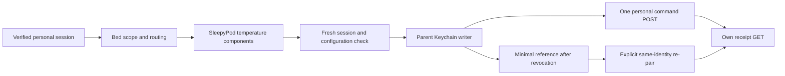

# Personal temperature runtime

Contract: Core `5cf2e7ce7df7aeb343d849148d470660b64bda97`, `docs/PERSONAL_CONTROL_API_V1.md`; the shared `personal-controls-v1.json` fixture is copied unchanged. This is a native API/client gate, not a live deployment or TestFlight release. Version stays 0.4.2 (15).

## Data and effect boundaries

The personal root mounts only its personal workspace. Its transport uses explicit personal credentials, fixed v1 routes, and no owner fallback, cookies, response cache, redirects, owner managers, or sensor streams. A ready session exposes the existing SleepyPod temperature dial and buttons with Degrees, Offset and Eight Sleep display choices. Solo accounts can have mixed requested targets; no default target is substituted. Measured, controller-reported target, requested target and power remain distinct. Observation expiry uses both the report timestamp and monotonic elapsed time.

Before each temperature, power or vibration-cancellation command, the workspace rechecks session identity, assignment and configuration. The parent workspace is the only Keychain writer: it stores the exact request body before the sole POST and merges updates into the latest account record. Lost responses, account switches and side moves retain the original attempt. Read-only receipt reconciliation never resends it. Unknown outcomes block ordinary adjustments; explicit Power off and Stop vibration remain available when the current scope authorizes them. A receipt is controller evidence, not physical verification.

Revocation removes the old credential, private drafts and command contents. Only unresolved receipt references survive in Keychain: verified Pod/household/account/sleeper IDs, request UUID, expiry and unresolved marker. They are hidden without a fresh matching session, including from an account with the same name or side. Explicit re-pairing of the same identity permits GET-only historical receipt lookup with the new credential. A reviewed unknown result remains unknown; a new adjustment is a separate deliberate request. Erase all local personal data also removes these references.

At most 64 unresolved requests/recovery references can be reserved globally. New requests fail before POST when capacity is exhausted; executing evidence is never silently evicted. Each account additionally retains its newest 30 completed/reviewed attempts. Storage failure fails closed.

## Verification scope

Focused contract, transport, lifecycle, concurrency and vault tests cover assigned/solo/unavailable states, foreign zones and scope changes, persisted bytes before dispatch, missing receipts, lost responses, stale observations and clock rollback, Stop during another request, account changes during awaits, receipt races, credential removal, cross-account recovery isolation, re-pairing, explicit erase and storage capacity. Synthetic UI scenarios use an in-memory actor and vault and cannot call real hardware. iPhone/iPad tests cover display choices, receipt review, private routine drafts, mixed targets, maximum Dynamic Type, disabled/unassigned accounts and the existing owner temperature views.

Routine publication, assignment activation, private history and Apple Health are separate gates. The displayed scheduled-vibration source comes from the server; this work does not physically qualify Right-side or middle-of-bed vibration, change routines, enable runtime flags, deploy the Pod, bump the app version or upload a build.
