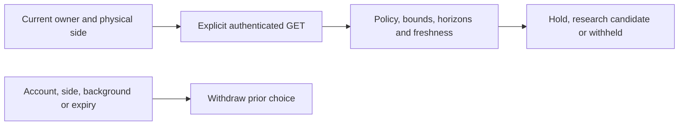

# Bounded target comparison

The temperature-learning screen can explicitly compare holding with an adjacent
one-degree target. It uses Core's `bounded-water-tracking-v1` policy, implemented
at `990c1aa4bcae77bffb97ff877474cc072904b0cf`. The shared synthetic fixture is
generated by that policy, rather than a separately written native answer.

`GET /api/v1/comfort/predictive/preview?side=left` is the only transport method.
Neither the native client nor the screen has an Apply control, temperature
mutation, training action or automatic request. Personal accounts cannot inherit
the owner's research evidence. Core keeps the sole command authority.

The screen presents a water-tracking objective, a choice, its reason, and
expandable alternatives with empirical ranges at 15 and 30 minutes. It identifies
practice data, supports Celsius and accessibility text, and uses the existing
native materials and typography. A prediction is not a measured body temperature
or evidence of improved comfort.

The native contract checks the fixed policy/version/mode/objective, physical
side, finite bounded targets, distinct hold/step comparisons, complete ordered
horizons, interval consistency, scores, disposition and a maximum 15-second
source validity. Future readings, contradictory selections and old responses
are rejected. Refresh first removes the prior choice; failure cannot resurrect
it. Account or side changes, backgrounding and cancellation fence late replies.
Expiry never sends another request or adjusts the bed.

The unit suite exercises shared-source decoding, malformed envelopes, wrong
side, future/expired data, account isolation, failed refresh and late replies.
Phone and tablet UI tests cover explicit reads, choice withdrawal and maximum
text size with Celsius. Passing these software checks does not qualify an
actual Pod, prospective predictions or automatic temperature control.

Prospective night collection and reviewed experiments are separate from this
on-demand presentation. The current routine, requested wake plan and personal
adaptation mode remain unchanged by this feature.
