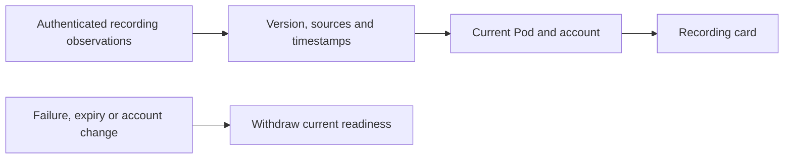

# Recording readiness on iPhone and iPad

Part of approved improvement 05. The Sleep screen shows the same equipment check
as Core's web app through the authenticated, read-only `GET /api/health/recording`
contract. It distinguishes sensor frames, recording/vitals processing, configuration
and recording database reads, available storage and recent signal interruptions.

The response's expiry follows its oldest underlying observation. The native view
also checks each observation and rejects unsupported versions, duplicate/missing
checks, future timestamps and extended freshness. Refreshing the view cannot renew
old evidence. It polls every 30 seconds while active, cancels with the view lifecycle
and ignores a delayed response from a previous owner/Pod. A failed read withdraws
the prior result. No recording status is persisted or used to issue commands.

The card explains equipment scope separately from sleep quality and Watch imports.
Details contain the checked time and practical next steps. Diagnostics remain one
level deeper. An older controller without the endpoint shows unavailable/update
guidance; it does not prevent the rest of the app from working. Personal-account
workspaces do not receive the owner endpoint or its observations.

On 10 November 2026, the signed iPhone simulator passed 11 unit/transport cases and
two UI cases. The signed iPad simulator passed the same two UI cases. They exercise
scope changes, late replies, invalid/expired observations, read failure, disclosure,
refresh and normal/extra-large text in dark/light appearances. Exported screenshots
were inspected. The result bundles are `/tmp/sleepypod-recording-native.xcresult`
and `/tmp/sleepypod-recording-ipad.xcresult` (iOS 27.0). SwiftLint strict passed.

Demo screens are synthetic and cannot establish physical Pod recording health.
No TestFlight release or physical deployment is claimed here. This change does not
enable temperature adaptation or change alarms.

## Full-row disclosure and refresh follow-up

Hosted iOS 26 checks exposed a disclosure label that did not expand the checks,
and an offscreen XCTest hit-point failure at the largest text size. The disclosure
now uses a full-width, at least 44-point button with an explicit expanded/collapsed
accessibility value. The refresh label itself owns its minimum 44-point hit area.
The tests wait for the asynchronous recording result, reveal controls in either
scroll direction, and assert expansion before examining storage and refreshing.

The corrected source passed both recording scenarios on signed iOS 27.2 phone and
iPad simulators. Earlier failed local and hosted receipts are retained; they are
not relabeled as successful runs. Final screen captures use `XCUIScreen`, since
app-bounded landscape captures from XCTest were offset and unsuitable for review.
The change does not alter polling, freshness, authentication or command authority.
The final phone and iPad runs each passed two cases with no skips. An independent
Impeccable review inspected all 12 closed/open/refresh captures and returned
`ship` for this narrow refinement. It does not establish VoiceOver, physical Pod
health, TestFlight distribution or compatibility with the hosted iOS 26 runtime;
the latter remains a required hosted check. Evidence is preserved under
`~/Library/Application Support/FreeSleep/diagnostics/2026-11-10/recording-disclosure`.
