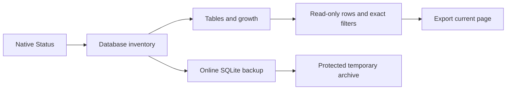

System → Status previously lacked the web database tools. This adds native inventory, integrity and migration details, retention/growth charts, exact-filtered row browsing with paging, page CSV copy/export, and streamed online database backups. It uses Sleepypod’s existing cards, theme and navigation.

Missing readings stay unknown. Changed filters clear old rows immediately; late replies cannot replace newer queries. Demo data is labeled and cannot run integrity checks or download backups. Exports use the configured owner connection and protected temporary storage.

The existing Status run-once Stop action also no longer swallows cancellation errors or sends an additional power-off after Core resumes the recurring schedule.

Validation and rendered evidence are recorded in `Integration/parity/SYSTEM_DATABASE_VALIDATION.md`. Tests use simulated transport/records and issue no live Pod commands. The remaining System/settings parity work and final TestFlight release continue separately.
