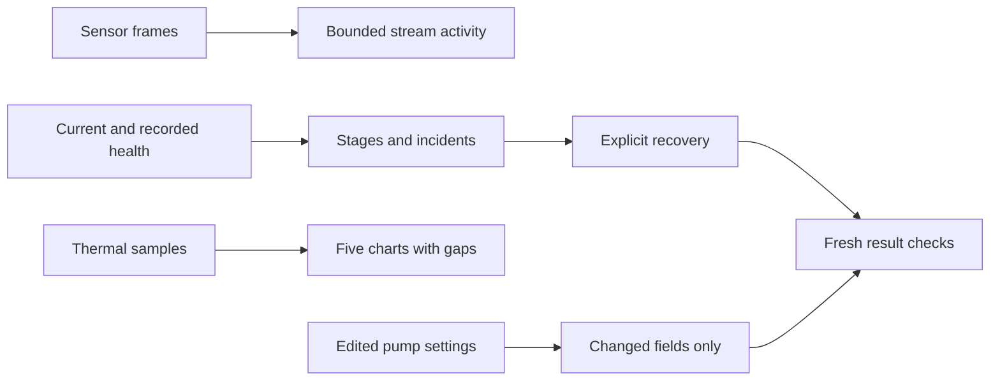

System lacked the web app's data-path diagnosis and thermal-history inspection. Health now exposes sensor-to-output stages, recorded gaps/incidents, live-frame activity and supported recovery actions. Thermal adds five synchronized history charts, selectable periods and current delivery readings. Pump protection uses explicit draft/save controls that send only changed settings.

Fresh health reads are required for recovery. Capacitance fixes wait for each side's new profile before queuing another. Unconfirmed restarts or saves require readback before retry. Missing chart data remains absent, and late responses cannot replace a newly selected history period.

Focused transport/state tests and responsive simulator evidence are recorded in `Integration/parity/SYSTEM_HEALTH_THERMAL_VALIDATION.md`. No live Pod restart, calibration, pump mutation or TestFlight release is included. The remaining dashboard, storage/hardware and broader settings audit continues separately.
