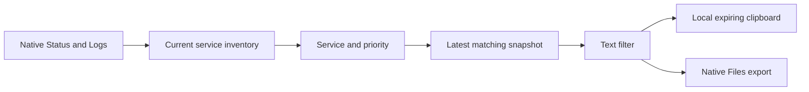

The native log viewer previously hard-coded service sources and omitted the web app's search, Follow/Pause and file export workflows. Both native entry points now share a source-aware log screen using Sleepypod's existing cards and navigation, with priority and line controls, matching-line copy/export, visible stale/error states and the existing firmware console.

Query changes invalidate old rows immediately, and late responses cannot replace the current selection. Original log lines are preserved for copy/export even when structured JSON is expanded for display. Clipboard contents stay local and expire after ten minutes.

Seven model/transport tests and the full iPhone, largest-text and Light iPad interaction flow pass. Evidence and limits are recorded in `Integration/parity/SYSTEM_LOGS_VALIDATION.md`. Tests use synthetic logs and simulated transport; no live Pod commands or new TestFlight release are included.
