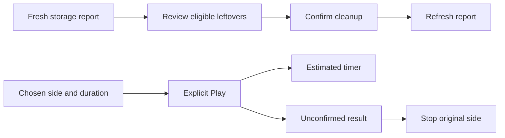

System now exposes the web app’s Storage workflow and single-side vibration tests through the native Sleepypod cards. Storage shows capacity, raw-history retention and eligible leftovers; old database backups remain excluded unless selected, and cleanup requires a review and confirmation. Hardware offers Quick, Standard, Long and Custom durations with explicit Play and Stop.

Cleanup rejects stale or changed candidate lists and requires readback after an uncertain result. Vibration acknowledgments start an estimated timer; uncertain requests preserve the original side for Stop and cannot start another test. Leaving the screen or expiring the timer never clears another side’s alarm.

Sixteen focused transport/state tests and the Storage/vibration flows on iPhone, iPad and maximum Dynamic Type pass. Health and Thermal also pass the maximum-text regression flows after the navigation change. Validation is recorded in `SYSTEM_STORAGE_VALIDATION.md` and `SYSTEM_HARDWARE_VALIDATION.md`. All interaction tests use in-memory demo data; no real Pod cleanup or vibration command is part of this change. The existing Core adapter also stops reporting missing hardware responses as healthy and stops inventing zero latency/signal measurements. Status opens in a full-screen native navigation stack, keeping long diagnostics scrollable while preserving the compact gear sheet for quick settings. The broader dashboard and settings audit continues separately.
