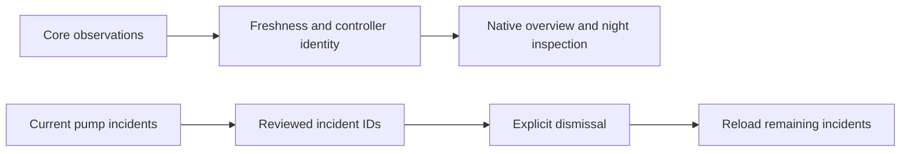

System now includes a native Overview with runtime/firewall facts, maintenance reminders, health/recovery links, a Pod-timezone night plan and per-side twelve-hour temperature inspection. Pump alerts expose incident details, acknowledged filtering, individual dismissal and review of all currently shown incidents using Sleepypod's existing cards and navigation.

Successful reads own their timestamps. Failed reads retain labeled data, cancelled or superseded requests cannot repopulate a changed connection, and missing hardware/network fields remain unknown. Pump dismissal preserves reviewed incident IDs, confirms each result and reloads without automatically retrying mutations. Internet changes require matching controller readback. Priming distinguishes request acceptance from reported circulation and uses model-specific manufacturer maintenance guidance.

Thirty focused transport/state tests pass. Overview/priming and pump-alert interaction flows are validated in iPhone dark, iPad light and maximum Dynamic Type, with captures under `Integration/parity/previews/system-overview/`. SwiftLint and the compiled-source presentation guard pass. Validation is documented in `SYSTEM_DASHBOARD_VALIDATION.md`; all tests use simulated data and no real Pod actuation. Version/build remains 0.2.0 (7), with the broader parity audit and final TestFlight release still pending.
