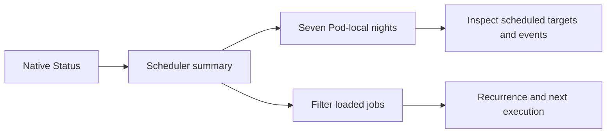

System → Status previously showed scheduler service health without the web app's job timeline. This adds native seven-night inspection, per-side scheduled targets and power/alarm markers, all nightly occurrences, the next five occurrences, and a searchable job list with recurrence and next execution details. It uses Sleepypod's existing cards, colors and navigation. Detailed Status views expand the gear sheet, while its quick-settings entry stays compact.

Night boundaries and chart times use the Pod's timezone, including 23/25-hour daylight-saving nights. Missing targets, next times and sync state stay unknown; stale snapshots are labeled. Unknown job types remain visible. Inspection sends no job or bed-control mutations.

Validation and retained simulator captures are recorded in `Integration/parity/SYSTEM_SCHEDULER_VALIDATION.md`. Fixtures do not establish live job execution; the remaining System/settings parity and final TestFlight release continue separately.
