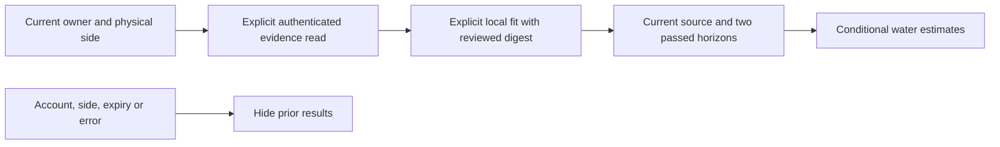

# Observed target-response research

This is native parity for Core's local conditional water-response evaluation,
not the separate morning-feedback model or an enabled predictive controller.
Core source: `b80c73f981dc033e862753753aaa7cbffe29f790`,
[PR 94](https://github.com/lucaandrea/sleepypod-core/pull/94).

## Contract and authority

- `GET /api/v1/comfort/response/model` reads the shared audit and saved evaluation.
- `POST /api/v1/comfort/response/train` submits only the side and reviewed dataset
  digest. A missing reply requires status readback; it is never automatically retried.
- `GET /api/v1/comfort/response/preview` reads guarded conditional estimates.

Every request uses the existing owner transport. Personal workspaces cannot read
these owner records. No target, measurement or context can be supplied through this
client, and it has no actuator method. The model remains on the Pod.

The screen is reached from Learning journey → Study small target changes. Checks,
fitting and preview are separate explicit actions. It distinguishes collection,
failed comparisons, stale sources and passing research previews. Unknown or
unsupported conditions produce no candidate estimate. Observed water is never
described as body temperature or a proven improvement in comfort.

Native validation checks source identity, side, immutable mode/version, counts,
disjoint chronological fitting/calibration/test groups, finite metrics, both ordered
horizons, and the actual comparison thresholds behind a passing flag. Status expires
after five minutes; live previews after 90 seconds. Account/connection/side changes,
backgrounding, cancellation and failed reads withdraw the corresponding state.
Temperature differences convert scale without subtracting the Celsius origin.

## Evidence

The fixture is generated from Core's artificial presentation schema and carries its
source commit. It contains no personal measurements. Demo mode uses a transport-free
practice client and labels every result as artificial.

The first build found a missing FreeSleepKit import; that failed receipt is retained.
After correction, 12 signed iPhone simulator unit/transport tests passed. They cover
malformed source metadata, dishonest passing flags, overlapping date groups, wrong
side, expiry/future clocks, preview bands, explicit-only requests, unconfirmed fit
readback, cancellation and account isolation. The v5 signed iOS 27.2 UI runs passed all three scenarios on both iPhone
and iPad, with no skips. They cover explicit evidence/evaluation/preview,
withdrawal when live readings disappear, absent evidence, failed comparisons,
changed source, unavailable reads, and maximum Dynamic Type with Celsius.
All 32 v5 screen captures were opened and checked.

An earlier combined receipt had passing unit checks but a UI failure: using the
last TimelineView tick made a newly fetched response appear future-dated. The
view now validates at render time, retaining strict future-clock rejection.
Visual inspection also found and corrected an unreadable prominent-button label
in dark mode using the existing Theme contrast pair. These original failures
are retained. The final eight-file strict SwiftLint check has no violations.
The independent v5 finish review requested two scoped repairs: containing
multiline labels within native button backgrounds and using an accessible text
color for practice/error prose in Light Mode. The follow-up uses native rounded
rectangles and primary text with a separate amber SF Symbol, preserving shared
Theme assets. The v6 recapture and hosted checks remain pending.

No physical phone, live Pod, TestFlight release or prospective response validation
has been performed for this increment. Neither fitting nor viewing a passing
comparison enables hardware control.
