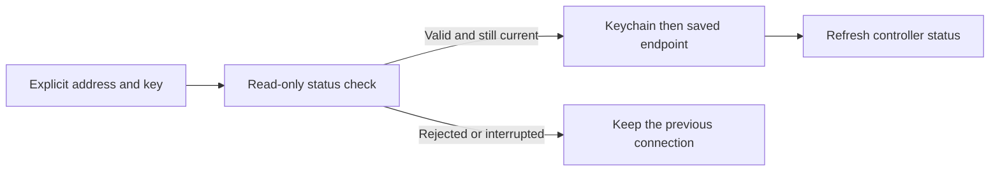

# Verify a connection before replacing it

The owner connection editor previously persisted a new address and key before
checking status. A mistyped address or rejected key could therefore replace the
working connection. The editor now checks the draft with a read-only request and
persists it only after a valid controller response.

## Contract

- Normalize the explicit address with the existing endpoint policy. Public remote
  connections require HTTPS. A supplied stream must use the same host and matching
  `ws`/`wss` transport, with no credentials, query, or fragment in its URL.
- Candidate credentials authorize only the selected backend's exact status GET
  path on the explicit origin. Existing redirect refusal remains in place. The
  draft cannot authorize a hardware command or a discovered host.
- Preserve the saved address and key on network, authentication, malformed-reply,
  cancellation, or stale-account failure. Invalidating the form withdraws a late
  success. Persistence failures have a separate message from network failures.
- Save to Keychain before replacing the saved endpoint. After commit, withdraw
  old manager and stream state and request fresh status. A verified connection is
  not proof of subsequent network availability or physical hardware operation.
- The software menu, address, and recovery text wrap at accessibility text sizes.
  The tablet uses the existing centered settings width. Checking disables edits
  and duplicate submission; authentication, network, and reply failures explain
  what to check without discarding the draft.

## Validation

Source and simulator evidence only; no phone, Pod, gateway, or credentials were
changed during this implementation.

- Eight focused enrollment tests cover origin/method restrictions, key handling,
  Core and legacy response parsing, failure preservation, commit ordering,
  account/form invalidation, cancellation, and persistence errors.
- Full native regression: 1,176 passed, nine existing skips. FreeSleepKit: 108
  passed. Combined: **1,284 passed, nine existing skips**. Receipts:
  `/tmp/SleepypodConnectionRegression-v8.xcresult` and
  `/tmp/SleepypodConnectionKitRegression-v7.xcresult`.
- Earlier full regression failures came from three test loaders using Mac
  checkout `#filePath` paths inside the simulator. They now read the identical,
  already bundled JSON fixtures. No expected values or assertions were removed;
  the original failing v7 receipt is retained.
- Signed arm64/x86_64 simulator build passed. Strict lint, workflow YAML parsing,
  shell syntax, and diff checks passed.
- Five UI scenarios run on iPhone and iPad: rejected key, network failure at
  maximum text size, unexpected reply, delayed success with disabled edits, and
  maximum text after rotation. DEBUG examples invoke the production form/state
  machine with an explicit simulated-response label and a no-op commit. They do
  not establish live network or credential persistence results.
- The earlier v8 application screenshots cropped the rotated iPad capture. The
  corrected harness waits for iPad landscape and captures the whole screen.
  iPhone supports portrait only; rotating that simulator is not evidence of an
  iPhone landscape layout. The failed v9 test build used an unavailable screenshot
  method; the corrected v10 build uses `XCUIScreen.main.screenshot()`.
- Independent review identified result feedback that required a second discovery
  scroll. The form now reveals its completion message and requests accessibility
  focus, respecting Reduce Motion. Tests assert the whole message is visible
  before any test-driven scroll. All five enrollment scenarios passed on each
  device in `SleepypodConnectionNightUI-iPhone-v12.xcresult` and the corresponding
  iPad result. The initial v11 iPad assertion incorrectly required a 24-point
  bottom inset where the visible safe area is 20 points; that failed receipt is
  retained. This is an accessibility-source check, not physical VoiceOver proof.
- The independent finish review passed after that repair: all 20 final captures
  were inspected and all 30 source/capture hashes matched. Its verdict is scoped
  to enrollment and does not qualify automatic routing or a deployed gateway.

## Remaining access work

This change verifies before saving one explicit connection. It does not yet
automatically select local/remote routes. The controller identity endpoint in Core
PR 96 is a separate foundation for verifying explicitly enrolled alternatives.
That identity is a logical installation UUID, not physical-device attestation.
Automatic route selection, account-specific alternatives, remote gateway setup,
and work-network/cellular/physical qualification remain separate acceptance gates.
