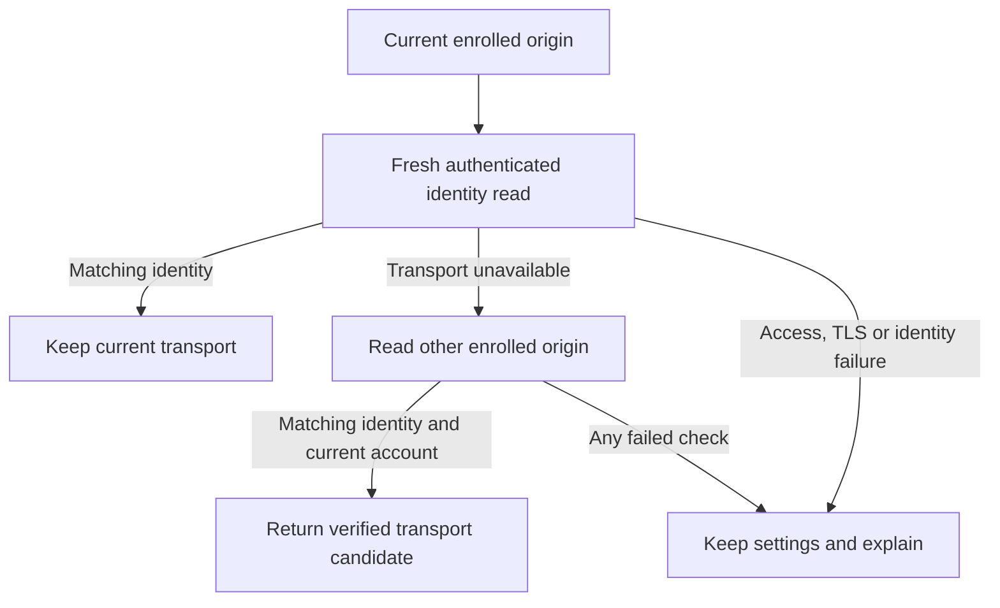

# Verified home and away connections

Explicit home/away enrollment now connects to foreground read-only recovery and
the app's saved transport. This is source and simulator evidence. No remote
gateway, physical phone connection, Pod setting, or controller command changed.

## Identity and credentials

`ControllerIdentityClient` sends a fresh 256-bit challenge to Core's authenticated
`GET /api/v1/connection`. The ephemeral production session refuses redirects. The
reply must retain the exact URL, JSON content type, challenge, product, schema,
and a valid installation UUID. Both declared and streamed bodies are bounded to
8 KiB. Cancellation and the personal-workspace boundary are checked around the
read. Anonymous and legacy controllers cannot enroll automatic alternatives.

The UUID identifies a persisted controller installation; a database clone or
restore can retain it. It is not hardware attestation or a replacement for TLS,
explicit origin selection, or the connection key.

`OwnerRouteVerification` validates both explicitly entered candidates before
sending either key, checks them sequentially, and requires the same identity.
Account changes and cancellation withdraw late results. `VerifiedOwnerRoutes`
stores canonical origins, stream addresses and credential digests, never keys.
Each origin must retrieve its own exact Keychain entry. Changed revision, key,
origin or invalid metadata requires verification again. The away origin must
use HTTPS.

## Selection

Keep the current route when its fresh authenticated identity matches. Only a
recognized transport failure can try the other explicitly enrolled route.
Authentication, TLS, malformed replies, redirects, HTTP server errors and a
different installation fail closed. A disabled profile, stale operation or
altered candidate cannot activate anything. A local activation failure is not
treated as a reason to retry another route. The service has no hardware methods.

## Validation and remaining integration

`SleepypodVerifiedRoutes-v1.xcresult` contains 22 passing focused tests: four
identity transport tests, ten route verification/selection tests and eight
existing single-connection enrollment tests. Coverage includes challenge replay,
wrong product/version/UUID, oversized and non-JSON bodies, rejected access,
redirect status, invalid shape, changed credentials/account, per-origin keys,
disabled profiles, late results, exact-once local activation and no fallback
after access/TLS/identity errors. The signed generic simulator build passed for
arm64 and x86_64; runtime evidence is the arm64 phone simulator. Strict lint
passed.

The following sections record the later encrypted persistence, enrollment UI,
transport recovery and stable identity work. A route change must neither erase
a valid backup alarm nor expose another account's data. Unacknowledged hardware
operations must never replay. Work-network/cellular access and actual device
behavior still require separate verification.

## Encrypted profile and identity anchor

`EnrolledOwnerRoutes` retains the original five-field owner revision while a
verified home/away transport changes. `OwnerRouteProfileStore` encrypts that
record with the existing device-local snapshot store. Loading checks the
backend, account boundary, credential revision, exact enrolled address and both
Keychain credential digests. A new owner revision cannot read the prior record;
changed keys or an unrelated origin withdraw it. Corrupt ciphertext raises an
unavailable-state error rather than pretending no profile exists.

Disabling automatic selection retains the original identity anchor so that the
eventual integration can preserve valid history and phone alarms. Re-enrollment
may retain that anchor only for the same verified installation. This metadata is
now used by the owner offline library, Health device identity, saved learning
contexts and app-owned backup alarm. Live requests still retain the changing
transport revision, so an old response cannot publish through a new connection.
Automatic lifecycle integration was still pending at this checkpoint.

Six profile tests passed alongside the 14 identity/selection tests in
`SleepypodRouteProfile-v2.xcresult` (20 total). They cover encrypted-at-rest
relaunch, both origins, personal workspace denial, changed keys/account/backend,
disabled selection, same-installation re-enrollment and corrupt ciphertext. The
signed generic simulator build and strict lint passed again for this addition.

## Stable data and alarm ownership

`OwnerDataIdentity` distinguishes a verified owner, a known departure and an
unavailable encrypted profile. Unavailable storage withholds personal reads and
new alarm writes without cancelling the existing alarm or erasing history.
A persisted expectation marker also distinguishes an unexpectedly missing
enrolled profile from a connection that has never enrolled alternatives.
Disabling selection retains the original data identity. A real owner/account
change still isolates personal records and reconciles the old backup alarm.

`SleepypodRouteIdentity-v5.xcresult` passed **1,315 unit/framework tests with nine
existing skips and zero failures** on the signed phone simulator. Regressions
cover home/away and relaunch continuity, encrypted-profile loss, credential
changes, unavailable identity during accepted/lost alarm replies, and unchanged
transport cancellation around Health reads. The earlier v4 run retained one
fixture failure because it used an HTTP public hostname; replacing the fixture
with a local address preserved the production HTTPS requirement. The generic
simulator build and strict lint passed. These tests do not establish remote
gateway, physical phone, alarm delivery or Pod behavior.

## Foreground enrollment and recovery

`OwnerRouteSession` verifies both addresses before storing the encrypted profile
and the alternate origin's Keychain entry. It cannot replace the active key as
an enrollment side effect. A failed profile write restores the previous alternate
key. Existing connections without a credential revision receive one while their
original data/alarm identity remains anchored to the earlier saved connection.

The Home and away form exposes verification, pause/resume, secure key entry,
optional streams and actionable Home/Away-specific errors. Backgrounding clears
typed keys and invalidates unfinished reads. While the form is open, automatic
recovery cannot replace its feedback or transport. Dismissal resumes recovery.

`OwnerRouteLifecycle` observes foreground network changes and checks every 30
seconds. A successful alternative selects its existing credential and replaces
the managers' transport, invalidating old requests and drafts. It sends no bed
commands and never retries an unacknowledged mutation. Personal workspaces and
other backends remain outside this owner-only lifecycle.

The away address still needs a separately provisioned authenticated HTTPS
gateway. Enrollment does not establish a tunnel or bypass a workplace VPN.
Automatic fallback refuses authentication, certificate and identity failures;
the same controller UUID is not physical hardware attestation.

### Validation, 11 November 2026

The initial 37 focused unit tests passed, then all four form scenarios passed on
signed iOS 27.2 iPhone and iPad simulators in `SleepypodRoutes-v3.xcresult` and
`SleepypodRoutes-iPad-v3.xcresult`. The complete pre-copy-review regression passed
1,327 tests with nine existing live-service skips and zero failures in
`SleepypodRoutes-regression-v4.xcresult`.

The independent review found ambiguous errors when two addresses were present.
Verification now retains the failed Home/Away role, offers matching recovery and
keeps raw server error text out of the message. Different controllers prompt the
user to enter two addresses for the same controller and confirm that nothing was
saved. The new failure cases retain cancellation semantics and stop before any
further verification or persistence. The revised iPad result
`SleepypodRoutes-iPad-v5.xcresult` passed 25 focused unit tests and four UI tests.

Earlier failed receipts are retained: the v2 UI fixture used keys shorter than
the real validator permits; v3 fixed only the synthetic credentials and added
fixture-readiness assertions. A v4 test compile failure compared whole candidate
values without Equatable conformance; v5 compares their explicit endpoints.
No production validation or success assertion was relaxed.

The final route unit/transport regression passed 1,330 tests with nine existing
live-service skips in `SleepypodRoutes-regression-v6.xcresult`. Final phone and
pad UI bundles (`SleepypodRoutes-iPhone-v7.xcresult` and
`SleepypodRoutes-iPad-v7.xcresult`) each passed all four scenarios. The v5 phone
capture exposed a clipped final sentence despite an AX-frame pass; measured
message height now drives the final scroll, and the complete v7 pixels were
inspected rather than relying only on accessibility geometry. Normal dark and
maximum-text light states, including iPad landscape, remain in the review packet.

The independent verdict pass scored the listed Home/Away recovery-copy and
visibility correction resolved (`ship`). It inspected all 18 v7 raw captures and
both landscape derivatives and independently confirmed four UI passes per class.
That verdict covers the correction and captured outcomes, not remote access,
physical hardware or a released build. The incumbent design system is preserved.
