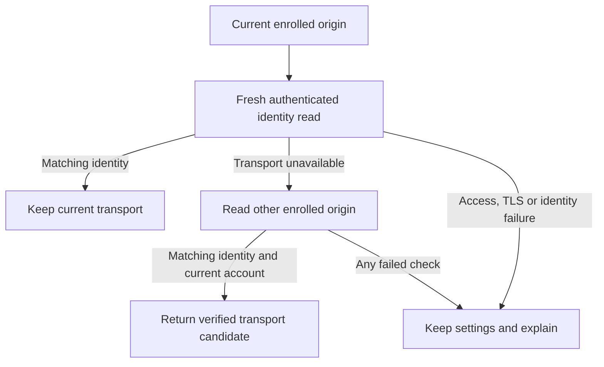

# Verified route selection foundation

This is tested source for explicit home/away enrollment and read-only selection.
It is **not connected to the app's saved connection or polling lifecycle yet**.
No remote gateway, phone connection, Pod setting, or controller command changed.

## Identity and credentials

`ControllerIdentityClient` sends a fresh 256-bit challenge to Core's authenticated
`GET /api/v1/connection`. The ephemeral production session refuses redirects. The
reply must retain the exact URL, JSON content type, challenge, product, schema,
and a valid installation UUID. Both declared and streamed bodies are bounded to
8 KiB. Cancellation and the personal-workspace boundary are checked around the
read. Anonymous and legacy controllers cannot enroll automatic alternatives.

The UUID identifies a persisted controller installation; a database clone or
restore can retain it. It is not hardware attestation or a replacement for TLS,
explicit origin selection, or the connection key.

`OwnerRouteVerification` validates both explicitly entered candidates before
sending either key, checks them sequentially, and requires the same identity.
Account changes and cancellation withdraw late results. `VerifiedOwnerRoutes`
stores canonical origins, stream addresses and credential digests, never keys.
Each origin must retrieve its own exact Keychain entry. Changed revision, key,
origin or invalid metadata requires verification again. The away origin must
use HTTPS.

## Selection

Keep the current route when its fresh authenticated identity matches. Only a
recognized transport failure can try the other explicitly enrolled route.
Authentication, TLS, malformed replies, redirects, HTTP server errors and a
different installation fail closed. A disabled profile, stale operation or
altered candidate cannot activate anything. A local activation failure is not
treated as a reason to retry another route. The service has no hardware methods.

## Validation and remaining integration

`SleepypodVerifiedRoutes-v1.xcresult` contains 22 passing focused tests: four
identity transport tests, ten route verification/selection tests and eight
existing single-connection enrollment tests. Coverage includes challenge replay,
wrong product/version/UUID, oversized and non-JSON bodies, rejected access,
redirect status, invalid shape, changed credentials/account, per-origin keys,
disabled profiles, late results, exact-once local activation and no fallback
after access/TLS/identity errors. The signed generic simulator build passed for
arm64 and x86_64; runtime evidence is the arm64 phone simulator. Strict lint
passed.

Before enabling selection, integrate encrypted profile persistence, explicit
enrollment UI, transport cancellation and reconnection, and stable identity
scopes for the offline library, reports, learning and app-owned backup alarms.
A route change must neither erase a valid backup alarm nor expose another
account's data. Unacknowledged hardware operations must never replay. Verify
work-network/cellular access and actual device behavior separately.

## Encrypted profile and identity anchor

`EnrolledOwnerRoutes` retains the original five-field owner revision while a
verified home/away transport changes. `OwnerRouteProfileStore` encrypts that
record with the existing device-local snapshot store. Loading checks the
backend, account boundary, credential revision, exact enrolled address and both
Keychain credential digests. A new owner revision cannot read the prior record;
changed keys or an unrelated origin withdraw it. Corrupt ciphertext raises an
unavailable-state error rather than pretending no profile exists.

Disabling automatic selection retains the original identity anchor so that the
eventual integration can preserve valid history and phone alarms. Re-enrollment
may retain that anchor only for the same verified installation. This metadata is
now used by the owner offline library, Health device identity, saved learning
contexts and app-owned backup alarm. Live requests still retain the changing
transport revision, so an old response cannot publish through a new connection.
Automatic connection lifecycle integration remains separate work.

Six profile tests passed alongside the 14 identity/selection tests in
`SleepypodRouteProfile-v2.xcresult` (20 total). They cover encrypted-at-rest
relaunch, both origins, personal workspace denial, changed keys/account/backend,
disabled selection, same-installation re-enrollment and corrupt ciphertext. The
signed generic simulator build and strict lint passed again for this addition.

## Stable data and alarm ownership

`OwnerDataIdentity` distinguishes a verified owner, a known departure and an
unavailable encrypted profile. Unavailable storage withholds personal reads and
new alarm writes without cancelling the existing alarm or erasing history.
A persisted expectation marker also distinguishes an unexpectedly missing
enrolled profile from a connection that has never enrolled alternatives.
Disabling selection retains the original data identity. A real owner/account
change still isolates personal records and reconciles the old backup alarm.

`SleepypodRouteIdentity-v5.xcresult` passed **1,315 unit/framework tests with nine
existing skips and zero failures** on the signed phone simulator. Regressions
cover home/away and relaunch continuity, encrypted-profile loss, credential
changes, unavailable identity during accepted/lost alarm replies, and unchanged
transport cancellation around Health reads. The earlier v4 run retained one
fixture failure because it used an HTTP public hostname; replacing the fixture
with a local address preserved the production HTTPS requirement. The generic
simulator build and strict lint passed. These tests do not establish remote
gateway, physical phone, alarm delivery or Pod behavior.
