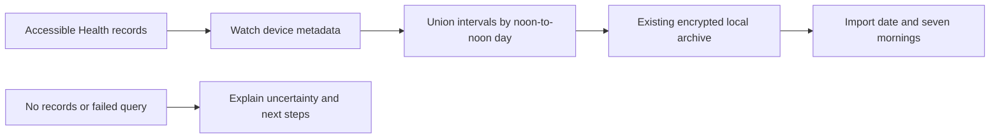

# Watch recording assistant

Approved improvement 06 adds a Watch-specific explanation of the private Health
history already used by personal reports. It is reachable from Sleep, the offline
Sleep library and Health history settings. It is independent of Pod connectivity
and the bed side selected in the UI.

## Evidence and privacy

Only `HKSourceRevision.productType` and `HKDevice` model/hardware metadata identify
Watch records. A source merely named Apple Watch does not qualify. Overlapping
intervals from multiple Watches are unioned. Other sources remain separated for
personal analysis and cannot inflate the Watch summary. Sleep-only intervals do
not establish wear time, whole-night completeness or the cause of a gap. Daylight
saving uses elapsed time inside calendar-based noon buckets.

The archive uses the existing encrypted `PersonalIntelligenceStore`. Older imports
without Watch provenance display refresh-needed; nil is distinct from a successful
empty read. A failed read preserves the prior history and reports, with an error
and the old successful-read timestamp. A successful empty read withdraws the old
coverage; it does not silently display it as current. Owner/boundary changes or
cancellation during an import prevent its commit. Personal preparation and demo
mode cannot read the owner's Health records.

## Automatic refresh

After the user has requested Health access, the existing refresh preference now
allows checks every 30 minutes from 04:00 to 14:00 in the device timezone, and every
six hours otherwise. Failed reads have a separate 15-minute retry floor. Both the
active app and the registered background Health task apply the same policy. Core
users can import local Health history without enabling Pod-to-Health writes.
Locked devices defer reads. Automatic reads never request new authorization.

iOS controls whether and when a background task runs; this is not a promised alarm
or scheduled import. No automatic model training, cloud report or raw Watch upload
to the Pod is added. The existing reviewed Watch-reference transfer remains separate.

## Apple references

- [Health authorization](https://developer.apple.com/documentation/healthkit/authorizing-access-to-health-data): absent results cannot establish denied access.
- [Protected Health data](https://developer.apple.com/documentation/healthkit/protecting-user-privacy): locked-device queries may be unavailable.
- [Watch sleep setup](https://support.apple.com/en-us/108906): sleep tracking, charging and review in Health.

Actual Watch synchronization, permission variants, a locked-device background wake
and delayed morning delivery still require physical-device verification. Simulator
fixtures cannot establish those behaviors or validate sleep accuracy.

## Software validation — November 10, 2026

The signed iPhone simulator suite passed 1,208 tests with nine documented skips,
including both Watch screens and recording-readiness UI flows. A subsequent focused
run passed all seven Health-refresh workspace cases after adding an unreadable
archive regression. Both Watch UI flows passed separately on iPad. Light/dark
screenshots and accessibility extra-extra-extra-large text were reviewed; refresh
and troubleshooting precede the seven-day history. Strict SwiftLint passed.

These checks exercise source attribution, interval union, DST and noon grouping,
refresh timing, locked-data deferral, failed and empty reads, account changes,
cancellation, archive preservation, and the absence of demo/personal-workspace
Health access. They do not establish physical Watch delivery or TestFlight release.
