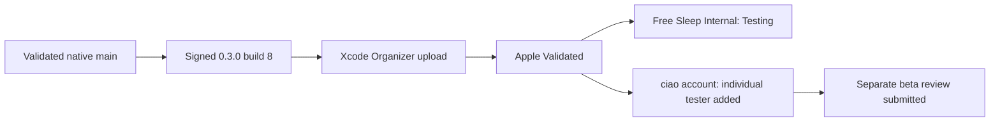

# Sleepypod 0.3.0 (8) — internal TestFlight delivery

26 October 2026, verified in Safari at 10:33 AM America/Los_Angeles.

## Delivery

- Xcode Organizer uploaded the signed archive successfully at 10:14 AM Pacific. The persisted upload receipt has zero errors and zero warnings.
- App Store Connect processed build `ea869ad8-5605-45f4-895e-da3008c51654` under the existing owner app `6822950204` and reports **Binary State: Validated**.
- **Free Sleep Internal** contains build **0.3.0 (8)** with status **Testing**, expiring in 90 days. The group contains the requested internal tester, **ciao@luca.ooo**.
- The same account was also added as a separate **Individual Tester (1)** on this build. Safari confirmed “1 tester has been added” and lists the account as **Installed 0.3.0 (8)**. This is App Store Connect's reported installation state, not an attended hardware or app-behavior test.
- Apple's individual-tester flow required **Submit for Review**. That separate beta review was submitted; the build detail offers **Remove from Review**. Internal group access is already active. No public App Store release was submitted.
- The prepared feature-oriented **What to Test** notes are saved and visible for this build.

[Build details in App Store Connect](https://appstoreconnect.apple.com/teams/2cea177f-0ba5-41e1-8e6a-6ea98af67b05/apps/6822950204/testflight/ios/ea869ad8-5605-45f4-895e-da3008c51654) · [Internal group builds](https://appstoreconnect.apple.com/teams/2cea177f-0ba5-41e1-8e6a-6ea98af67b05/apps/6822950204/testflight/groups/1dbd6a43-c813-47aa-81cb-6589f2be1c5e/builds)

## Source and archive identity

- Validated implementation: `193cf9d1733db76c92a9695197a31f8ea332049a`; integrated into main at `ecde9906b8e4425b34abb230b56dc47942bfe418` with an identical code tree. Native PRs #34–39 and all earlier feature PRs are merged.
- Release metadata: `4264be98ee2a074a7108e0bdc94905924a89fcb6` sets 0.3.0 (8) in `project.yml` and the generated Xcode project. The only project changes are the version fields, matching the already signed archive's explicit version overrides. No source, dependency, resource or signing-setting change required a second archive.
- Archive: `~/Library/Developer/Xcode/Archives/2026-10-26/Sleepypod-0.3.0-8-candidate.xcarchive`.
- The original local export and signature/privacy/license evidence are recorded in [parity-candidate.md](parity-candidate.md). Its IPA hash identifies that local export; the actual upload is independently evidenced by Organizer's persisted distribution receipt and the processed Apple build above.
- App Store Connect confirms bundle `com.lucaandrea.freesleep`, version 0.3.0, build 8, minimum iOS 26.0, arm64, symbols included and no non-exempt encryption. App/Watch distribution identifiers and team match; HealthKit and HomeKit are enabled on the app and development debugging is disabled on both bundles.

The implementation passed **936 tests, five explicit live-Pod skips and no failures** on both local iOS 27 and remote iOS 26. Phone, iPad and maximum-text interaction evidence is recorded in [the final reconciliation](../parity/FINAL_RECONCILIATION.md). Local release evidence is under `build/parity-validation/`: `release-project-equivalence.json`, `xcode-upload-build8-receipt.json` and `testflight-build8-progress.json`.

## Remaining hardware work

The ESP's last USB diagnostic confirmed Wi-Fi connected and sample Preview disabled. It has no configured live Core controller. The owner has deferred USB reconnection; final endpoint/key provisioning and fresh sensor/base/alarm reads remain pending the coordinated attended Pod handoff. TestFlight delivery does not establish physical bed movement, alarm delivery, Health writes, Home pairing, Siri invocation or overnight comfort qualification.

