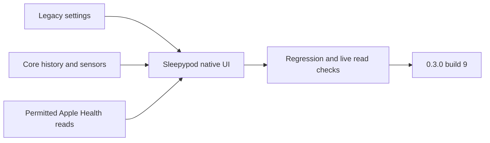

# Home feedback recovery — 0.3.0 (9)

This update addresses the failures reported after testing build 8 at home. It retains Sleepypod's native presentation and the existing app identity.

## Changes

- Legacy settings may omit `rebootTime`; the app keeps it absent rather than failing the whole settings response or inventing a reboot time.
- Every service included in the status total appears in a category. Nonhealthy services also appear in a separate attention card.
- Connection settings display the saved or discovered origin, explain the retained Keychain key, and allow local controllers that do not require a key.
- Overnight curves place preparation before bedtime, retain distinct settling points when the wake time changes, and keep deleted settling phases savable.
- Analysis reads complete paginated imported presence, vital and movement history, counts those sources separately, and charts original vital measurements. Historical vital samples are not relabeled as sleep sessions or model-training labels. The overview loads up to 250,000 records per archive kind; larger sources remain available through the date-filtered archive browser.
- Apple Health sleep history is read across the available date range after existing read consent. Failed or unavailable reads remain visible. Personal model training, sleep-stage inference and Pod temperature automation are explained separately.
- Late model responses cannot replace a newer side's result. Unsupported controllers receive a readable explanation; the source badge correctly identifies a Pod model.
- The app registers its Shortcuts on launch, features next-alarm read/change/skip actions, links to its system Shortcuts library, and provides six sleep-focused workflow recipes. All 16 underlying actions remain available. Recipes do not silently create automations.

## Verification

Focused settings/status/connection and overnight-curve regressions pass. Archive tests exercise 650 bed records and a separate 1,100-vital-record source without inventing bed sessions. Health tests verify read-consent gates and distinguish failed reads from empty history. Read-only acceptance uses the actual native clients against the owner's Core controller and checks decoded settings/schedules/status, complete archive counts and six fresh bed temperatures. Credential contents and personal measurements are excluded from fixtures and this report.

Phone and iPad UI checks cover the analysis overview, maximum accessibility text, connection prefill, sleep recipes and system Shortcuts handoff. Strict lint, reproducible feature-import reconstruction and the compiled-presentation guard pass. The final regression result and distribution evidence will be recorded after their runs complete.

Live GET checks do not establish physical vibration, scheduled wake delivery, base movement, Health writes, Home pairing, spoken Siri execution or overnight comfort qualification. Attended Pod controls remain coordinated with the backend chat. The ESP still needs its protected controller configuration over USB; its last accepted firmware already has Wi-Fi configured and Preview disabled.

