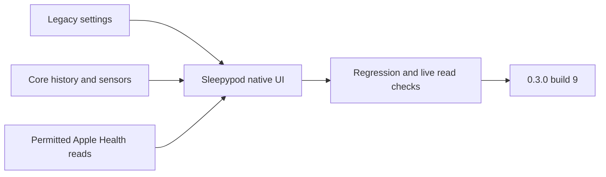

# Home feedback recovery — 0.3.0 (9)

This update addresses the failures reported after testing build 8 at home. It retains Sleepypod's native presentation and the existing app identity.

## Changes

- Legacy settings may omit `rebootTime`; the app keeps it absent rather than failing the whole settings response or inventing a reboot time.
- Every service included in the status total appears in a category. Nonhealthy services also appear in a separate attention card.
- Connection settings display the saved or discovered origin, explain the retained Keychain key, and allow local controllers that do not require a key.
- Overnight curves place preparation before bedtime, retain distinct settling points when the wake time changes, and keep deleted settling phases savable.
- Analysis reads complete paginated imported presence, vital and movement history, counts those sources separately, and charts original vital measurements. Historical vital samples are not relabeled as sleep sessions or model-training labels. The overview loads up to 250,000 records per archive kind; larger sources remain available through the date-filtered archive browser.
- Analysis charts scale with accessibility text and use fewer axis ticks to keep measurement labels readable.
- Apple Health sleep history is read across the available date range after existing read consent. Failed or unavailable reads remain visible. Personal model training, sleep-stage inference and Pod temperature automation are explained separately.
- Late model responses cannot replace a newer side's result. Unsupported controllers receive a readable explanation; the source badge correctly identifies a Pod model.
- The app registers its Shortcuts on launch, features next-alarm read/change/skip actions, links to its system Shortcuts library, and provides six sleep-focused workflow recipes. All 16 underlying actions remain available. Recipes do not silently create automations.

## Verification

Focused settings/status/connection and overnight-curve regressions pass. Archive tests exercise 650 bed records and a separate 1,100-vital-record source without inventing bed sessions. Health tests verify read-consent gates and distinguish failed reads from empty history. Read-only acceptance uses the actual native clients against the owner's Core controller and checks decoded settings/schedules/status, complete archive counts and six fresh bed temperatures. Credential contents and personal measurements are excluded from fixtures and this report.

The final local iPad run on iOS 27 passes **958 checks, zero failures and five explicit physical-startup skips** (963 total). It combines 954 unit/transport/live-read checks with four UI checks. The separate final iPhone UI run passes all four checks. Both sizes cover the analysis overview, maximum accessibility text, connection prefill, sleep recipes and the system Shortcuts handoff. The UI harness centers large accessibility rows and closes the iPad system Shortcuts sidebar before asserting action visibility; it still requires the next-alarm action to be hittable.

Strict SwiftLint reports zero violations across 464 files. Reproducible feature-import reconstruction and the compiled-presentation guard pass. Local result bundles are `build/parity-validation/home-feedback/final-ipad-v4.xcresult` and `final-phone-ui-v2.xcresult`. Earlier failed UI attempts are retained separately and are not counted as successful suites. [PR #40](https://github.com/lucaandrea/sleepypod-ios/pull/40) tracks remote validation and integration.

Live GET checks do not establish physical vibration, scheduled wake delivery, base movement, Health writes, Home pairing, spoken Siri execution or overnight comfort qualification. Attended Pod controls remain coordinated with the backend chat. The ESP still needs its protected controller configuration over USB; its last accepted firmware already has Wi-Fi configured and Preview disabled.

## Initial signed candidate and accessibility follow-up

Xcode successfully archived and exported **0.3.0 (9)** from production source `2fcbd78a29112b80336349364541f8da9c3c8bea`. Visual review subsequently found crowded chart axes at the largest accessibility text size. The follow-up scales chart height with text and reduces axis ticks. The package below is preserved as the initial candidate and will be superseded by a rebuilt build 9 before upload.

- Organizer archive: `~/Library/Developer/Xcode/Archives/2026-10-26/Sleepypod-0.3.0-9-candidate.xcarchive`.
- Export: `build/parity-validation/Export-0.3.0-9-candidate/Sleepypod.ipa`, 30,166,469 bytes.
- IPA SHA-256: `e0d7a8f44aebaae3a53b522209af88ecd99fa8d7ba37ada125256369942e66b4`.
- App and Watch pass strict signature verification, have matching build/version identities and distribution profiles, and disable development debugging. The app retains HealthKit and HomeKit entitlements.
- App, Watch, framework and SDK privacy manifests and license notices are bundled. App Intents metadata contains 16 actions and 10 featured Shortcuts. Compiled release sources exclude the retired Free Sleep presentation.

Organizer currently requires its Apple account to be signed in again before upload. Safari remains signed into App Store Connect, where build 8 is the latest visible upload. Build 9 has not been delivered to TestFlight. The accessibility follow-up must pass its UI rerun and a fresh signed archive/export before upload. The owner has been asked to complete the Xcode sign-in dialog; group/tester assignment follows successful upload and processing.
