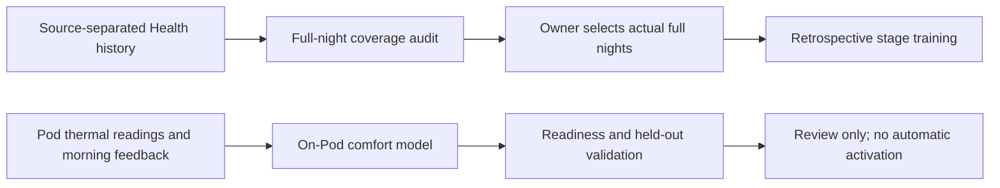

# Complete-night learning and personal reports

The app distinguishes Health history, personal sleep-stage training and the
temperature model fitted on the Pod. A saved Health day is not automatically a
complete training night. Missing signals are shown as missing, never synthesized.

## Sleep stages

Check recording coverage before training. The audit groups fragments into Pod
timezone nights and requires 6–12 hours with at least 90% matched presence,
heart-rate, movement and Watch-stage coverage. It excludes ongoing recordings,
large gaps and conflicting Watch labels. Overlapping fragments cannot appear in
different training folds. The owner explicitly selects actual full nights;
changed signals, connection identity, side or feature contract require rechecking.

At least five confirmed nights and the existing epoch minimum are required.
Normalization currently uses the complete night, so this estimator remains
retrospective and must not drive real-time heating. Watch stages are a comparison
source, not clinical ground truth. Models trained in a superseded owner/side
scope are discarded before promotion.

## Temperature model

Personal comfort shows a separate card when Core advertises `modelTraining`.
It reads `/api/v1/comfort/model` and explicitly fits through
`/api/v1/comfort/model/train`, bound to the dataset hash that was reviewed.
The status distinguishes complete reviewed thermal nights, morning check-ins,
exclusions and saved model validation. Demo training remains disabled. Existing
Core versions retain the older learning summary without calling new endpoints.

Core requires twenty matching complete nights with actual thermal observations
and morning feedback. Historical Health sleep totals cannot replace these inputs.
The fit runs locally on the Pod and never activates temperature control. Its
validation errors describe feedback direction, not degrees Fahrenheit or proven
sleep benefit. See the Core repository's `docs/AUTOPILOT_MODEL_PLAN.md` for the
model design, research, evaluation baselines and remaining activation gates.

## Reports

The shipping report renderer supports headings, inline emphasis, lists, quotes,
simple tables and fenced code. Tables and code scroll within their cards. Known
evidence references remain visible as source badges; generated links do not
become actionable destinations. Health history uses separate adaptive metric
cards and keeps detailed source facts in a disclosure section.

## Validation boundary

Full-night coverage and model-contract tests, renderer tests and simulator UI
checks cover filtering, authenticated requests, disabled demo training and
presentation, including accessibility text sizes. They do not prove live Pod
adoption, sufficient personal training data, TestFlight installation or better
sleep outcomes. No Health data or private audit exports belong in this repository.

