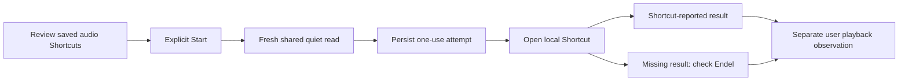

# Endel bedtime audio

Approved improvement 20: start the selected Endel mode on the selected bedside
HomePods, at the chosen volume and duration, with visible audio state and a
tap-to-finish path. The original requested volume is 35 percent.

## Verified platform boundary

Research checked on November 12, 2026:

- [Endel's Siri setup](https://endel.zendesk.com/hc/en-us/articles/360021256179-You-want-to-launch-Endel-on-your-iPhone-with-Siri-Shortcuts)
  adds mode actions inside Endel. The user can combine these with Shortcuts.
- [Endel's guide](https://endel.zendesk.com/hc/en-us/articles/360015068699-User-Guide)
  documents Sleep, Relax, AirPlay and an in-app timer. That does not establish
  which timer parameters its installed Shortcuts actions expose.
- [Apple's URL contract](https://support.apple.com/en-euro/guide/shortcuts/apd624386f42/10.0/ios/27)
  runs an already-saved Shortcut and passes text input.
- [Apple's callback contract](https://support.apple.com/en-asia/guide/shortcuts/apdcd7f20a6f/ios)
  reports completion, cancellation or error. Completion is not proof of audio
  reaching a HomePod. Sleepypod ignores callback text rather than presenting it
  as a trusted device observation.

No private Endel API, generic playback command, fabricated stream observation,
background Wait timer, or automatic replay is used. Audio from a different app,
an active call, or a manually changed route is not ours to take over silently.

## Implemented native handoff engine

`BedtimeRitualSession` operates against injected account, foreground, quiet-read,
URL-opening and secure-storage boundaries. `BedtimeRitualConnection` binds the
real owner/personal quiet clients and protected Keychain to that engine. The
native flow is connected to Tonight and personal accounts. One app-level
workspace retains the current session across the Shortcuts handoff and sheet
dismissal. The installed Shortcuts and HomePods still require physical setup and
qualification; the app does not create them or infer their capabilities.

1. Save a per-account setup after the user reviews the configured Start and Pause
   Shortcuts, Endel mode, speaker destination, volume and timer. Changing a setting
   requires another setup review; an unreviewed previous handoff must be resolved
   first. Settings are expectations of the reviewed Shortcut, not evidence that
   Shortcuts has actually applied them.
2. A foreground Start reads shared quiet state immediately. Unknown, stale,
   contradictory, foreign-account and paused readings withhold the handoff.
   Switching accounts or leaving the foreground during that read also withholds it.
3. Save the attempt to device-only Keychain before opening Shortcuts. The URL
   contains requested audio settings and a one-use return token. It contains no
   Pod credentials, account identifier, Health history or clipboard data.
4. Mark the request as handed off only after the system accepts the URL. A
   matching callback can report Shortcut completion; it never marks physical
   playback. The user can separately record hearing the selected speakers,
   hearing nothing, or observing playback stop.
5. A lost callback, elapsed two-minute window, reversed clock, account change or
   process restart cannot trigger another launch. A restored in-flight attempt
   becomes unknown. The person checks Endel and explicitly acknowledges the
   previous result before a fresh Start can occur.
6. Pause uses the separately reviewed Pause Shortcut, requires confirmation that
   this is still the audio the person started, and is allowed during quiet time.
   It neither invokes a generic media toggle nor claims that a callback proves
   the speakers stopped. A pause cannot act on a session older than 12 hours.

These guards apply at launch. They do not promise automatic interruption of
already-running audio if another sleeper requests quiet afterward. A callback
token correlates an untrusted app return; it is not remote authentication.

## Native workflow

The grouped form leads with the latest handoff and its separate user observation.
A new request scrolls its result into view. Initial setup requires explicit review
of the exact saved Shortcut names and expected settings; changing any field
withdraws that confirmation. Setup does not change a Shortcut or start media.

The `Open bedtime audio` App Intent is discoverable as an action in Shortcuts and
opens this review. It does not launch Endel or run a media action. Its metadata is
present in the built app. The `sleepypod-bedtime` callback scheme is registered;
only a current session's one-use return can update the result. A callback after
process restart cannot recover a trustworthy live completion.

Personal callbacks survive a normal foreground/background trip to Shortcuts,
while changed account, removed credentials or protected-data loss withdraw the
session. Erasing or forgetting a personal connection removes its audio setup and
history from Keychain. Account removal does not claim to stop external audio.

## Remaining delivery work

- Deploy the owner shared-quiet endpoint (merged Core PR 137) and release the native workflow. The
  owner adapter checks installation identity around its read; the personal adapter
  checks its complete session on both sides. Neither changes credential type.
- Finish the browser/iPad companion instructions and the same state vocabulary;
  their source and browser checks are in the separate Core guide change.
- Inspect the installed Endel actions and configure/test the actual Start/Pause
  Shortcuts. Confirm how its timer is applied. A setting unsupported by the
  installed actions needs an explicit tap-to-finish step in Endel.
- Verify routing, 35-percent volume, timer, interruption by calls, failure to
  route, pause, partner quiet and return-to-app behavior on the actual iPhone and
  HomePods. Unattended occupancy-triggered playback remains unqualified until
  those observations establish what the platform can actually do.
- Release through the existing native and Core workflows. No live audio,
  household settings or Pod routines were changed during this implementation.

## Validation

The native tests exercise external-effect ordering, callback races and expiry,
quiet/account/foreground changes during asynchronous work, secure per-account
storage, process restart, lost persistence and explicit pause/observation.
The signed iPhone simulator integration run passes **47 tests, zero skips** in
`/tmp/sleepypod-endel-ui-models-v4.xcresult`. This includes real Keychain round
trips, production URLSession adapters with intercepted HTTP responses, retained
callbacks, account removal, protected session withdrawal and personal background
transitions. Strict SwiftLint passes on the new production files.

The first UI pass exposed offscreen result navigation on iPhone. A new request
now brings the result section into view, and the test locator can correctly find
virtualized content above or below the viewport. The final eight-scenario run
passes on both iPhone and iPad, including the actual Tonight entry, initial
connection recovery, custom field labels, Pause results and account withdrawal:
`/tmp/sleepypod-endel-ui-phone-reviewed-v2.xcresult` and
`/tmp/sleepypod-endel-ui-ipad-reviewed.xcresult`. The 43 validated captures include
light appearance, dark appearance at the largest accessibility text size and
iPad landscape. They are in `.impeccable/review/bedtime-audio-reviewed/`.

The complete application/framework regression run passes **1,720 tests, zero
failures and nine existing skips** at
`/tmp/sleepypod-endel-review-regression.xcresult`. Its initial run caught a test
fixture using separate clock reads for a strict 15-second interval. The fixture
now derives both timestamps from one instant; production freshness checks are
unchanged. The original failed run remains at
`/tmp/sleepypod-endel-ui-full-regression.xcresult`. The first transport-test
compile needed two missing `try` keywords; its failed result remains at
`/tmp/sleepypod-endel-transport.xcresult`. No real Shortcut or HomePod was invoked.

The independent native reviewer scored all four material fixes resolved after
inspecting the 43 recaptured images: truthful first-connection recovery,
persistent setup-field labels, Pause-specific result copy and manual stop
guidance after account withdrawal. The verdict covers those four fixes; actual
audio and device qualification remain separate. The first phone recapture run
failed because the test looked above an offscreen custom field instead of below
it; the locator was corrected without changing production behavior or weakening
its visibility assertion. That failed result remains at
`/tmp/sleepypod-endel-ui-phone-reviewed.xcresult`.
