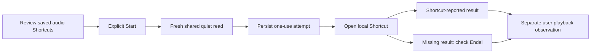

# Endel bedtime audio

Approved improvement 20: start the selected Endel mode on the selected bedside
HomePods, at the chosen volume and duration, with visible audio state and a
tap-to-finish path. The original requested volume is 35 percent.

## Verified platform boundary

Research checked on November 12, 2026:

- [Endel's Siri setup](https://endel.zendesk.com/hc/en-us/articles/360021256179-You-want-to-launch-Endel-on-your-iPhone-with-Siri-Shortcuts)
  adds mode actions inside Endel. The user can combine these with Shortcuts.
- [Endel's guide](https://endel.zendesk.com/hc/en-us/articles/360015068699-User-Guide)
  documents Sleep, Relax, AirPlay and an in-app timer. That does not establish
  which timer parameters its installed Shortcuts actions expose.
- [Apple's URL contract](https://support.apple.com/en-euro/guide/shortcuts/apd624386f42/10.0/ios/27)
  runs an already-saved Shortcut and passes text input.
- [Apple's callback contract](https://support.apple.com/en-asia/guide/shortcuts/apdcd7f20a6f/ios)
  reports completion, cancellation or error. Completion is not proof of audio
  reaching a HomePod. Sleepypod ignores callback text rather than presenting it
  as a trusted device observation.

No private Endel API, generic playback command, fabricated stream observation,
background Wait timer, or automatic replay is used. Audio from a different app,
an active call, or a manually changed route is not ours to take over silently.

## Implemented native handoff engine

`BedtimeRitualSession` operates against injected account, foreground, quiet-read,
URL-opening and secure-storage boundaries. `BedtimeRitualConnection` binds the
real owner/personal quiet clients and protected Keychain to that engine. The
native presentation and app routing remain to be connected; adding these files
does not expose a working audio button yet.

1. Save a per-account setup after the user reviews the configured Start and Pause
   Shortcuts, Endel mode, speaker destination, volume and timer. Changing a setting
   requires another setup review; an unreviewed previous handoff must be resolved
   first. Settings are expectations of the reviewed Shortcut, not evidence that
   Shortcuts has actually applied them.
2. A foreground Start reads shared quiet state immediately. Unknown, stale,
   contradictory, foreign-account and paused readings withhold the handoff.
   Switching accounts or leaving the foreground during that read also withholds it.
3. Save the attempt to device-only Keychain before opening Shortcuts. The URL
   contains requested audio settings and a one-use return token. It contains no
   Pod credentials, account identifier, Health history or clipboard data.
4. Mark the request as handed off only after the system accepts the URL. A
   matching callback can report Shortcut completion; it never marks physical
   playback. The user can separately record hearing the selected speakers,
   hearing nothing, or observing playback stop.
5. A lost callback, elapsed two-minute window, reversed clock, account change or
   process restart cannot trigger another launch. A restored in-flight attempt
   becomes unknown. The person checks Endel and explicitly acknowledges the
   previous result before a fresh Start can occur.
6. Pause uses the separately reviewed Pause Shortcut, requires confirmation that
   this is still the audio the person started, and is allowed during quiet time.
   It neither invokes a generic media toggle nor claims that a callback proves
   the speakers stopped. A pause cannot act on a session older than 12 hours.

These guards apply at launch. They do not promise automatic interruption of
already-running audio if another sleeper requests quiet afterward. A callback
token correlates an untrusted app return; it is not remote authentication.

## Remaining delivery work

- Release the owner shared-quiet endpoint and bind the current app account to its
  ritual session. The implemented owner adapter checks installation identity
  around its read; the personal adapter checks its complete session on both sides
  of the read. Neither falls back to the other credential type.
- Add the native ritual screen, clear status labels, setup instructions, and
  user-initiated Start/Pause actions. Register the callback scheme in the app and
  route through one current session. Add an App Intent that opens this workflow.
- Provide the browser/iPad companion instructions and the same state vocabulary.
- Inspect the installed Endel actions and configure/test the actual Start/Pause
  Shortcuts. Confirm how its timer is applied. A setting unsupported by the
  installed actions needs an explicit tap-to-finish step in Endel.
- Verify routing, 35-percent volume, timer, interruption by calls, failure to
  route, pause, partner quiet and return-to-app behavior on the actual iPhone and
  HomePods. Unattended occupancy-triggered playback remains unqualified until
  those observations establish what the platform can actually do.
- Release through the existing native and Core workflows. No live audio,
  household settings or Pod routines were changed during this implementation.

## Validation

The native tests exercise external-effect ordering, callback races and expiry,
quiet/account/foreground changes during asynchronous work, secure per-account
storage, process restart, lost persistence and explicit pause/observation.
The final signed iPhone simulator run passes **32 tests, zero skips** in
`/tmp/sleepypod-endel-transport-fixed.xcresult`. This includes real Keychain
round trips and production URLSession adapters with intercepted HTTP responses.
Strict SwiftLint passes on all six production files. The first transport-test
compile needed two missing `try` keywords; the failed result is retained at
`/tmp/sleepypod-endel-transport.xcresult`. No real Shortcut or HomePod was invoked.
