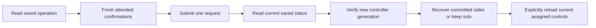

# Native attended household maintenance

This implements the native contracts, isolated transport, recoverable state and
personal-account screens for the controller's household transition API. The root
checks maintenance before exposing ordinary controls or account editors, preserves
sign-out, and reloads the current assignment after explicit completion. An approved
shared review offers a separate attended activation only when the controller enables
it. This source change does not enable public household activation or change a bed.

## Contracts and ownership

`ArrangementMaintenanceStatus`, receipt types and cancellation previews reject
unexpected fields, mismatched operations, impossible state combinations, stale
observations and mismatched account revisions. Recovery and cancellation remain
distinct from routine-service startup and physical bed behavior. Maintenance can
follow an assignment revision only for the same Pod, household, account and
sleeper; it never retargets ordinary controls to a new person.

Each action has its own exact confirmation set, request identifier and lifetime
of at most sixty seconds. The transport permits only fixed maintenance paths,
an optional operation UUID and the anchored personal credential. It uses ephemeral
networking, disables cookies/cache, rejects redirects, bounds responses and does
not retry mutations. The controller additionally enforces the original owner
device and its activation flags.

The workspace brackets status reads with account checks, withdraws private state
after an account change or backgrounding, and retains its operation identifier
through an uncertain reply. Restart receipts prevent repeated restart requests.
Recovery requires a committed operation and verified new controller generation;
keeping solo requires a fresh digest-bound cancellation preview. Ordinary controls
can reopen only after a new terminal-state read with command admission open.

## Evidence

`Integration/FixtureGenerators/generate-household-maintenance.ts` loads only the
pure Core contracts from a tracked-clean source checkout. The checked-in fixture
records its source commit and contains eight synthetic projections and four
validated requests. No database, network service or hardware starts during fixture
generation, and no personal data is included.

The focused simulator run passed 40 contract, transport, workspace and existing
household tests. These cover stale/mismatched receipts, extra private fields,
distinct confirmation sets, numeric values masquerading as consent, expired
requests, exact authenticated routes, no retries, lost restart replies, new
generation recovery, cancellation expiry, assignment changes, account revocation
and backgrounded late responses. Focused strict SwiftLint also passed.

Initial checks retained two test-only compile mistakes and a URLProtocol fixture
assumption: URLSession supplies the POST body as a stream. The test now reads the
bounded stream and still requires an exact match with the intended request bytes.
No networking assertion was removed.

Before screen integration, the full native regression completed 1,105 tests with
zero failures and nine existing skips. After integration, 29 focused tests passed,
including six new account-boundary cases for initial reads, stale status, ordinary
editor withdrawal, backgrounded responses, sign-out and explicit completion reload.
The final unit/framework regression completed 1,111 tests with zero failures and
nine existing skips. Strict app-wide SwiftLint passed. The first boundary-test compile exposed a missing
test import and an incorrect fixture constructor; both were corrected.

The DEBUG-only maintenance preview uses synthetic fixtures and in-memory transports.
Phone/tablet acceptance passed 12 scenarios on each device, covering separate activation, single restart, recovery,
keeping solo, unresolved results, sign-out and accessibility text sizes. These runs
also include ordinary personal preparation and shared-review screens
because their initial loading moved to the stable household root.
After clarifying the filled-reservoir confirmation and capability-dependent account
copy, the app was rebuilt and three affected UI scenarios passed again on each
device. The final build and strict lint passed. Phone and tablet screenshots were
inspected in dark appearance and at the largest accessibility text size in light
appearance. Generated project inputs retained every existing source and resource.

Hosted checks and distribution are separate remaining gates. Public activation also
requires private learning migration and an attended physical window. No simulator
result establishes physical occupancy, movement, vibration or thermal behavior.
