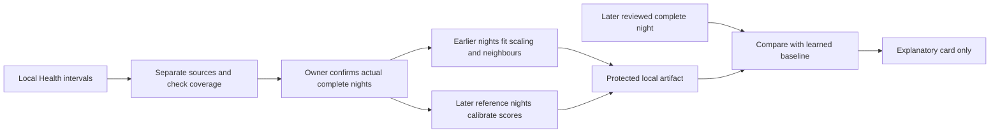

# Native model learning

## What the old Status screen meant

“Sleep Stage CNN — Not trained” and “Anomaly Detection — Not trained” were hard-coded placeholders. The screen also reported a fixed 3/3 healthy count. It did not inspect model files. The app already bundled a trained random forest and implemented personal logistic-regression and random-forest training.

Settings → Intelligence models now reads real availability and links to complete-night auditing, personal stage training and the new night baseline. Status links to the same workspace. A loaded research model is not automatically selected as the user's classifier.

## Research and choice of model

- [Walch's PhysioNet dataset](https://physionet.org/content/sleep-accel/1.0.0/) has 31 subjects, wrist motion/heart rate and simultaneous laboratory sleep labels. Data license: ODC-By 1.0; [method implementation](https://github.com/ojwalch/sleep_classifiers): MIT. The [paper](https://pmc.ncbi.nlm.nih.gov/articles/PMC6930135/) describes wearable classification, not validation of this Pod's mattress signals.
- The bundled card reports forest subject-held-out κ 0.3477 and accuracy 0.5357 on 2,664 epochs. Its upstream developer's nine Pod nights report κ 0.1217 and accuracy 0.3723. These are **upstream card results, not Luca's validation**, and explain why a wrist-trained model must not silently replace the current classifier. Existing dataset/method attribution stays bundled.
- Personal fitting uses [Create ML random forests](https://developer.apple.com/documentation/createml/mlrandomforestclassifier) and logistic regression. Five complete reviewed paired nights are an engineering minimum, not clinical validation. Hold out whole nights, compare identical epochs, require κ above both baselines by 0.05 and a majority of nights won before selection. More neural-network parameters cannot replace matched labels and independent evaluation.
- Apple's [on-device updates](https://developer.apple.com/documentation/CoreML/personalizing-a-model-with-on-device-updates) require an updatable model and appropriate data. An SDK or LLM API key cannot train a missing physiological classifier automatically. Current stage normalization uses complete nights, so inference is retrospective.
- [Novelty detection](https://scikit-learn.org/stable/modules/outlier_detection.html) compares new observations with a reference distribution. We implement a small five-nearest-neighbour model in Swift, with persisted learned vectors. No new package or Core ML label is needed. It does not diagnose disease.
- Chronological calibration avoids mixing adjacent nights randomly. It does not guarantee calibrated probabilities under personal drift; see [Oliveira et al., 2024](https://jmlr.org/papers/v25/23-1553.html). The app reports an empirical reference rank, never a probability of illness.

## Night model contract: `night-neighbors-v1`

- Read the last 180 days; separate source bundle, hardware product and available device identifier. Reject this app's own predictions as input.
- Group using the Pod timezone, noon to noon; split gaps above 30 minutes. Windows must be 6–12 elapsed hours, have six recorded sleep hours, 90% coverage and no gap over 30 minutes. Wait an hour after the last sample. In-bed samples are not sleep. Reject conflicting stages; deduplicate samples.
- Coverage identifies candidates only. A six-hour partial night can look intact: the person must confirm actual full-night wearing/recording. Tests and partial nights stay unselected. Changed intervals invalidate review tokens.
- **Review latest 40 nights** offers a source-specific date range and requires explicit confirmation before selecting those candidates. Individual switches remain available. The pending selection captures the exact records and owner scope; new/changed nights, source changes or owner changes reject that confirmation. It preserves other existing reviews and never starts training automatically.
- Original Eight Sleep/Oura duration summaries can inform timing/duration after review; they cannot label mattress epochs. Summary-only sources do not invent zero awake time.
- Required features: sleep minutes and local-clock midpoint. Detailed stages can add awake fraction. Optional Watch features: median overnight HR, SDNN HRV and respiratory rate, matching source/device with enough sample spread. No daily averages, cross-source borrowing or zero imputation.
- Fit the latest 40–90 reviewed nights. Reserve `max(20, n/3)` later nights for calibration; at least 20 earlier nights fit the model. Choose optional columns using training data only; calibration must supply those columns. Vitals default off so sparse data does not silently change the sleep/timing model's meaning.
- Use a circular training midpoint anchor and training-only median/MAD scaling. Fixed scale floors: 15 minutes duration/timing, 0.02 awake fraction, 2 bpm, 5 ms SDNN, 0.5 breaths/min. These prevent constant or rounded data from making the model hypersensitive.
- Score mean RMS-normalized distance to five nearest training nights. Compare to the later calibration's 95th empirical percentile, with minimum distance 1. This prevents a five-minute midpoint shift in otherwise identical data being called unusual. These are engineering choices, not clinically validated cutoffs.
- Only a later independently reviewed night produces a result. Training/calibration nights never count as new evidence. Baselines over 45 days old are withheld. Changed, deleted or unreadable reference samples require a fresh review.

## Privacy and lifecycle

The artifact contains learned vectors, scales, calibration scores and evidence hashes. It is personal data, atomically saved in private Application Support with complete iOS file protection and excluded from backups. Health consent, owner/connection changes, timezone changes and personal-account boundaries invalidate in-flight work. A fresh Health read must verify saved references before producing results. Deleting a model leaves Health intact.

There is no notification, publishing, hardware or Autopilot command path. Personal-account members do not inherit the owner's Health model; this workspace stays behind the existing owner-only Health boundary.

## Validation scope

Unit tests cover chronological separation, midnight wrap, constant/rounded data, source isolation, corrupt artifacts, clock rollback, stale baselines, changed evidence, gaps, conflicts, duplicates, in-bed exclusions, DST and private persistence. UI tests check actual bundled model loading and readiness at normal and maximum text size. Synthetic fixtures test software only; they are not training data shipped to the user or evidence of improved sleep.

Bulk-review regressions cover source boundaries, changed records, newly arriving nights, owner changes, preserving earlier selections and the explicit review → fit → protected reload workflow. The Mac can build and test this workflow without occupying the owner's phone. Original Health interval evidence remains on the phone; cached daily report summaries cannot replace it for training or reference validation.

Personal accuracy and useful anomaly detection still require prospective, reviewed complete nights. Neither a passing build nor an artifact establishes medical accuracy, improved sleep outcomes or qualified autonomous temperature control.
