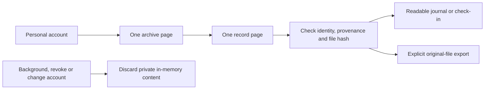

# Private saved learning on iPhone and iPad

Personal account → Browse saved learning opens the private history preserved
during a completed, reviewed side change. Original journal dates, sensor sides,
notes and model files remain attached to their original custody record.
Reading or exporting this history does not train a model or change the bed.

## Contract and privacy

Core PR 110 merged as `31b034d56d5c7d832705276e60b92223d943d5d7` after
all seven hosted checks passed. Its tree matches tested source
`68760eca8738b8719986f3e47d60ba63c2a9ef96`. The native fixture is generated
from that source's pure contracts and synthetic browser example:

- Fixture: `Integration/Fixtures/personal-learning-v1.json`.
- SHA256: `c3729be6528fa2725b12eb8ca8da8add57c69ebcb542e23fed1c6c0f57fdadcc`.
- Generator: `Integration/FixtureGenerators/generate-personal-learning.ts`.

Run the generator with the Core checkout's `tsx`, passing `--tsconfig` for that
checkout and then its path as the script argument. It requires a tracked-clean
Core checkout and never opens a database, device, account or service.

The client permits only the fixed personal session and learning GET routes.
Every request uses the pinned personal credential and sleeper identity; there
is no installation-owner fallback. Ephemeral networking disables cookies,
credentials, shared caches and redirects. Streaming limits bound both advertised
and actual response sizes. A response must match its exact scope, selector,
archive hash and selected record. The original payload's UTF-8 byte count and
SHA256 are verified without parsing and re-encoding its contents; large SQLite
integers remain exact. Unknown fields, malformed dates and inconsistent archive
counts are rejected.

Each read checks the complete personal session before and after receiving data.
Foreground views also recheck access. Backgrounding, sign-out, changed identity,
maintenance and invalid or failed reads discard private bodies. A late response
cannot repopulate a discarded view. Ordinary navigation cancellation does not
mistake a cancelled access check for account revocation. Stop uses an independent
transport and remains available while a library request is pending.

The workspace retains one archive page, one record page and one selected body
in memory. Nothing enters defaults, the pairing vault, Health or a model store.
Explicit export creates a temporary document only after the user asks. Cancelling
or leaving the screen clears that document; a successfully exported copy remains
where the user chooses to save it.

## Reading and accessibility

Known journal entries and comfort check-ins render as readable facts and notes.
Other records keep a clear historical label and offer their original file for
review. Redacted content remains unavailable. Empty, disabled and failed reads
explain the state and available next step. Native navigation, Form rows, source
disclosure and the system export picker retain the incumbent app presentation.
Light/dark appearance and the largest Dynamic Type size are part of the phone
and tablet acceptance matrix.

## Validation and remaining gates

Contract, transport and workspace checks cover scopes, original bytes, strict
keys, oversized/truncated bodies, disabled capabilities, no retries, paging,
changed accounts, backgrounded late reads, parent lifecycle and Stop independence.
The DEBUG-only preview uses synthetic records and in-memory transports. The
focused UI suite covers readable details, source disclosure, export cancellation,
empty/unavailable/error states, maximum text size and foreground recovery.
The existing personal-recordings suite runs alongside it on phone and tablet.

The complete app and framework suites executed 1,132 tests on the iPhone
simulator: 1,123 passed, nine existing cases skipped, and none failed. This includes 21 new contract, transport
and workspace cases. Ten UI walkthroughs passed on each device class: the five
existing recordings scenarios and five new library scenarios. Strict SwiftLint
and the source whitespace checks passed. Subsequent review corrected the new
error text's light-mode contrast and waited for the system export picker's Save
control before capturing it. The focused repeat passed five phone scenarios (the iPad-only landscape case was
skipped on phone) and all six tablet scenarios. A full-screen landscape recapture
also passed after replacing XCTest's clipped app-only rotated screenshot.

Receipts are `/tmp/sleepypod-native-learning-final-phone.xcresult`,
`/tmp/sleepypod-native-learning-final-ipad.xcresult`, and the subsequent
`/tmp/sleepypod-native-learning-review-{phone,ipad}.xcresult` bundles. These use
Xcode 27.2 simulator runtimes; hosted checks separately target Xcode 26.3.
Earlier failed captures and assertions remain in separate result bundles.
Source tests and simulator checks do not establish live Pod migration or physical
acceptance.
This addition does not enable household activation, enroll historical files into
training, delete records or change the TestFlight build number.

## Independent finish review

The independent Impeccable reviewer inspected all 22 valid simulator captures.
Its one material finding was the missing navigation affordance on archive and
record rows. Both now use trailing SF Symbol chevrons with unchanged navigation
and lifecycle behavior. The complete browsing/export-cancellation path passed
again on phone and tablet, and the reviewer scored that fix resolved with a
`ship` disposition at the verdict-pass scope. Native Form, Theme, typography and
system export presentation remain consistent with the surrounding account flow.
The native-only review did not use the HTML/CSS detector. No new design system
or change to incumbent design files was introduced.
