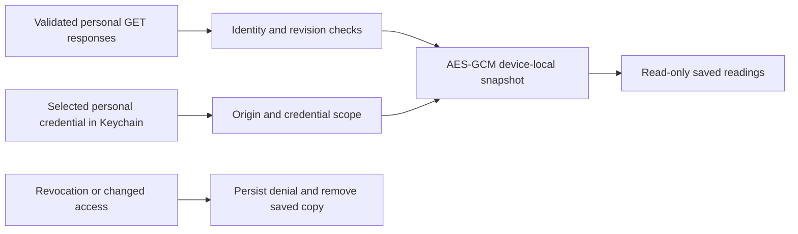

# Personal saved readings

Approved improvement 02 extends to personal accounts through **Personal account →
Open your saved readings**. A previously paired account can open downloaded Pod
recordings and its last read operating week when the controller cannot be reached.
This is separate from the installation owner's offline library and reports.

## Contents and meaning

- Each recording type retains its most recently requested range and up to 300
  fetched records. The original query can cover seven, thirty or ninety days.
  Partial lists are labeled; older unfetched records are not fabricated.
- A new first page replaces that type's previous range. Pagination requires the
  same query, attribution revision, ordered nonduplicate records and a remaining
  page. An attribution change discards the previous types rather than combining
  incompatible snapshots.
- Complete source intervals, source-side attribution and missing values remain
  intact. Bed presence is not called sleep duration, movement is not called sleep
  stages, and Pod HRV is kept separate from Watch HRV.
- The weekly copy contains only the fetched **operating** routines, controller time
  zone, temperature unit and revision. It excludes draft weeks, invitation secrets,
  publication requests, review authority and pagination cursors. It does not
  include one-time wake overrides or establish that a future alarm will fire.
- Each recording type and the week has its own successful-read time. An outage,
  malformed response or failed encrypted write cannot advance an old copy's time.

## Privacy and lifecycle

The existing `PrivateSnapshotStore` supplies authenticated encryption, device-only
Keychain storage, complete file protection and backup exclusion. The namespace is
bound to the connection identifier, exact origin, device credential and person
identity. The complete saved session must also match current local account
revisions before restoration. Neither plaintext fallback nor owner-library fallback
exists.

A network outage preserves a previously fetched copy. An explicit authentication,
access or identity rejection withdraws it. The account coordinator persists an
offline denial before deleting ciphertext; failed deletion leaves restoration
blocked until a verified refresh successfully completes cleanup. Remote revocation
cannot be discovered while the device is disconnected; the saved copy is explicitly
historical, never proof of current server access.

Account switching, returning to owner controls and backgrounding withdraw visible
bodies. Closing a personal session keeps the pairing and encrypted copy. Revoking
the device or erasing all local personal data removes that copy as well. Removing
the copy from its own screen preserves the pairing and server data.

The offline reader has no transport or actuator API. It cannot publish a routine,
change a temperature or create a delayed command. Live editors keep their existing
fresh authorization requirements.

## Acceptance

Store, workspace and parent-boundary tests cover encrypted round trips, substituted
and tampered files, identity/credential/origin changes, delayed reads, pagination,
source revisions, clock rollback, locked keys, outages, revocation and erasure.
UI checks cover reading and removing copies, process relaunch, empty/protected
storage, large text, both appearances and phone/tablet layouts.

On 11 November 2026, the signed iPhone simulator run passed **1,509 tests** with
zero failures and nine existing skips, including sixteen personal saved-reading
model/boundary tests and five UI walkthroughs. The signed iPad run passed all five
UI walkthroughs. Both exercised the production Keychain implementation for saved
copy relaunch and removal. The two transport warnings concern deliberate HTTP
fixtures at documentation-only test addresses; no home endpoint was used.

The first unsigned run is retained: its largest-text UI test incorrectly waited
for a lazy Form row before scrolling. The corrected test waits for the account
screen, then verifies that the row can be reached without reducing the text size.
Screenshot review also found XCTest's application crop was stale after iPad
rotation; final captures use the complete screen instead. These are test/capture
corrections, not evidence of a physical-device check.

The final screen-capture runs each passed all five UI cases with no warnings.
An independent native finish review inspected all 28 original screenshots,
matched the image/source hashes and returned **ship** with no material fixes at
this feature's scope. The established native design files were preserved. The
results, failed-run history and review packet are retained in the local diagnostics
archive under `2026-11-11/personal-offline-library`.

This document describes implementation. Test results, independent design review,
hosted validation, TestFlight and physical-device verification must each be recorded
before claiming their corresponding acceptance. Personal Health enrollment and
personal report generation are separate household work; this reader does not expose
the owner's report archive to another person.
