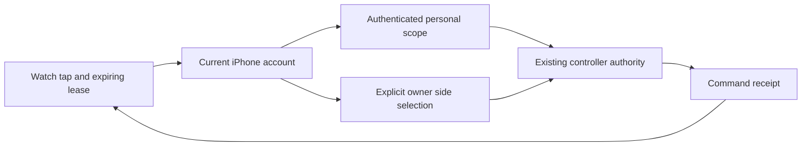

# Everyday Watch bed controls

Status: implemented and model-tested locally; hosted release, physical paired-device
acceptance and interactive simulator review remain separate gates. No live Pod settings changed.

The Watch's Bed destination offers one-degree Fahrenheit changes, Stop temperature,
the effective next wake and Stop vibration. The optional movement recorder remains
under Research recording. Alarm editing remains on iPhone. This uses the paired
phone's reachable WatchConnectivity session, not an independent Watch network route.

## Delivery and identity

Requests expire after 15 seconds. Display leases expire after 30 seconds and thermal
observations after 15 seconds. The phone also uses monotonic elapsed time. The shared
client and phone broker reject changed identities, expired readings and mismatched
responses. Duplicates and uncertain commands are never replayed. Stop preempts an
adjustment still awaiting preflight. An acknowledged request is not physical proof.

A personal account never falls back to the owner's connection. Solo assignment may
cover both zones; split targets are displayed without inventing a shared target.
Personal writes use the existing persisted command receipt. Wake reads derive the
scope from `/api/v1/me/alarm/next` and use the same effective occurrence as Core's
scheduler, including skip/away/override handling. Core PR 123 merged as
`9359745ec431b6c70ec667c3b3b6a96493b5d981`; its tree matches tested
`8feee8fa2ffe313e915888f586c58e08796f3b94`. Old Core versions show wake
unavailable while retaining independently verified temperature controls.

## Background behavior

Apple documents that a live Watch message can wake the paired iPhone app in the
background. Household control credentials use AfterFirstUnlockThisDeviceOnly, as
the existing owner connection does. A readable legacy account vault migrates in
place. Invalid data or unavailable secure storage fails closed without replacing
identity, saved commands or private drafts. If the process launched before the
first phone unlock, a later Watch refresh retries that vault before capturing its
account boundary. The owner command ledger is also opened lazily and retried after
unlock; a failed initial open cannot disable the whole Watch bridge for the process
lifetime or block a personal-account connection. Health snapshots and AI-provider keys are unchanged.

- [Live Watch messages](https://developer.apple.com/documentation/watchconnectivity/wcsession/sendmessage(_:replyhandler:errorhandler:))
- [Keychain accessibility](https://developer.apple.com/documentation/security/restricting-keychain-item-accessibility)
- [Device-only background access](https://developer.apple.com/documentation/security/ksecattraccessibleafterfirstunlockthisdeviceonly)

## Verification

The shared client tests cover expiry, loss of connection, interruption, no replay,
Stop while an adjustment waits, invalid response identity and account invalidation.
Phone tests cover account recovery, storage failure, scope and wake reads, expiry,
command deduplication and final preflight. Real simulator Keychain tests require
normal simulator signing; an unsigned run returned errSecMissingEntitlement (-34018)
and is retained as a failed invocation, not a production-vault regression.

Required physical checks before declaring delivery: current TestFlight install with
paired Watch; phone locked after first unlock; phone restarted before/after first
unlock; temporary Bluetooth/network loss; actual temperature/Stop/vibration receipts;
account switch/revocation; and unchanged research recording behavior. The phone/Watch
must be available, and hardware actions require the current attended bed window.

The integrated application/framework suite passes **1,600 tests**, with nine existing
live-service skips. Strict SwiftLint passes across 671 files, workflow YAML parses,
and whitespace checks pass. The simulator test job retains normal local signing for
real Keychain checks; the unsigned physical-iOS build remains unsigned. Sixteen
synthetic simulator captures cover 42mm and 49mm ready, stale, split, offline, wake,
large-text, wake-large-text and recorder states. The large-text fixture is an explicit
SwiftUI accessibility3 override because simctl does not expose watchOS content size.
Captures do not prove taps, digital-crown operation or physical settings.

Independent presentation review identified one missing wake-screen context: the
person and the explicit demonstration label. Both are now shown with the assigned
side. The four affected normal/large-text wake captures were regenerated at both
Watch sizes, and the reviewer cleared that fix. This verdict covers presentation;
paired-device delivery, actual Watch gestures and VoiceOver remain unverified.
