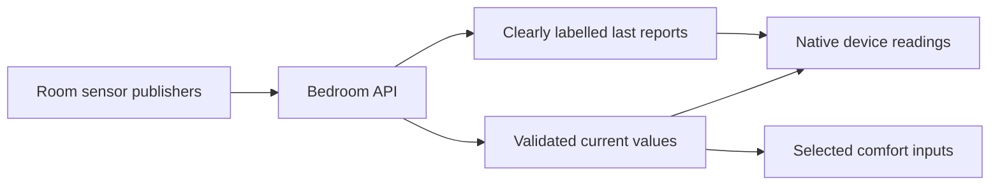

# Room sensor readings

Settings → Room sensors shows the configured bedroom devices directly. The Temperature, Schedule and room-aware Autopilot cards also show individual climate and air-quality readings, including display-only sources. Pod environment measurements have their own “Pod sensors” label.

Each reading has one of three presentations:

- Current: a validated report whose controller receipt and source lease remain fresh.
- Last reported: a real retained value with its original timestamp and a cached, expired, unavailable or waiting status. It never substitutes for a current reading or contributes to comfort control.
- Missing: no value, with a provider-specific explanation of the required publisher.

Discovering a HomePod for audio does not deliver its temperature or humidity. Apple Home, Homebridge and Home Assistant must send reports to the controller through their configured publisher. The iOS app does not manufacture reports or change existing pairings.

Regression coverage is in `BedroomContextTests`, `BedroomTransportTests` and `BedroomDevicesUITests`. It covers cached and expired values, restart history, zero values, degree conversion, direct navigation, compact cards and accessibility text sizes. UI fixtures are explicitly labelled synthetic.

`HomeFeedbackLiveTests/testLiveRoomSourcesDeliverActualReports` is a separate opt-in, read-only acceptance check. Set `TEST_RUNNER_POD_FEEDBACK_URL` and `TEST_RUNNER_POD_FEEDBACK_KEY_FILE` locally when invoking Xcode tests. The credential remains in a protected local file. The test requires a recent accepted report from every enabled source; waiting placeholders, expired reports and history withdrawn after a restart fail acceptance. It prints only counts and does not prove sensor calibration or physical accuracy. Cached exports can prove report delivery, but cannot prove a fresh physical measurement.
